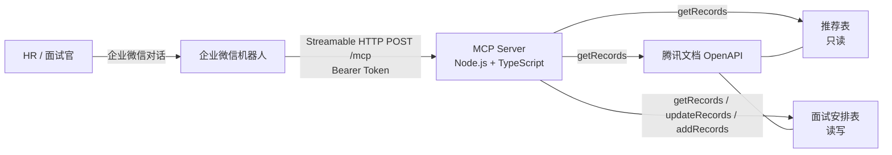
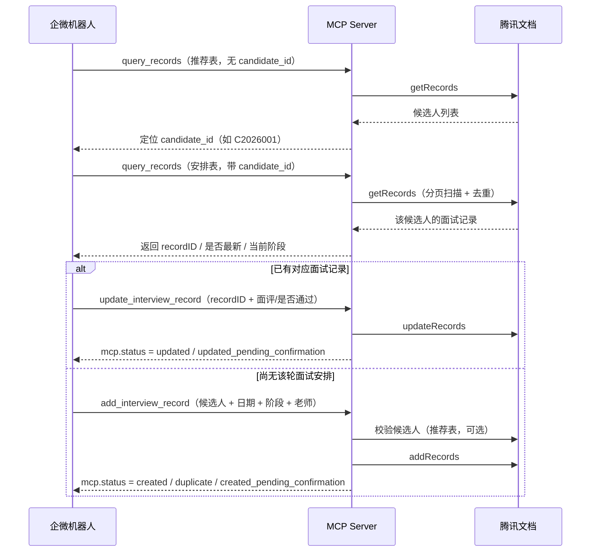

# 腾讯文档智能表 MCP Server

面向**企业微信招聘机器人**的 [MCP（Model Context Protocol）](https://modelcontextprotocol.io/) Server。
它把腾讯文档智能表中的「候选人推荐表」与「面试安排表」包装成三个 MCP 工具，让机器人可以：

- 查询候选人 / 面试记录（按 `candidate_id` 去重、定位 `recordID`）；
- 更新面试安排表的面评与是否通过；
- 新增面试安排（候选人校验、重复约面检测、低置信度待确认）。
- 通过 **Streamable HTTP** 单端点 `/mcp` 接入，无状态、便于重启与水平扩展。

> 需求依据：`docs/腾讯文档智能表MCP-需求文档.md`。本文中的字段格式、错误码与规则均与需求文档保持一致。

---

## 目录

- [架构](#架构)
- [三个工具](#三个工具)
- [典型调用流程](#典型调用流程)
- [本地开发](#本地开发)
- [环境变量](#环境变量)
- [Docker 部署](#docker-部署)
- [企业微信机器人接入](#企业微信机器人接入)
- [没有公网域名时怎么办](#没有公网域名时怎么办)
- [HTTP 接口](#http-接口)
- [返回结构与错误码](#返回结构与错误码)
- [日志、安全与隐私](#日志安全与隐私)
- [已知待确认项](#已知待确认项)

---

## 架构



技术要点：

| 项 | 实现 |
|----|------|
| MCP SDK | `@modelcontextprotocol/sdk`（`McpServer` + `StreamableHTTPServerTransport` / `SSEServerTransport`） |
| 传输 | 主推 Streamable HTTP `/mcp`（无状态）；兼容 SSE `/sse` + `/messages`（有状态） |
| HTTP | Express 5 |
| 日志 | pino JSON 结构化日志 |
| 测试 | vitest（工具层使用 mock 的腾讯文档客户端，不访问真实 API） |
| 部署 | Docker 多阶段构建（node:22-alpine，非 root） |

传输方式：

- **Streamable HTTP（`/mcp`）**：每个 `POST /mcp` 新建 `McpServer` + `StreamableHTTPServerTransport`，响应结束后关闭；不返回 `Mcp-Session-Id`；`GET/DELETE /mcp` 返回 `405`；请求需带 `Accept: application/json, text/event-stream`。
- **SSE（`/sse` + `/messages`）**：`GET /sse` 建立长连接并下发 `endpoint` 事件；客户端把 JSON-RPC 消息 POST 到 `/messages?sessionId=...`；会话保存在进程内，连接关闭自动清理。
- 两种传输共享同一套工具实现，可同时启用。

---

## 三个工具

| 工具名 | 中文名 | 对应官方接口 | 类型 | 写表 |
|--------|--------|--------------|------|------|
| `query_records` | 查询记录 | `getRecords` | 只读 | 否 |
| `update_interview_record` | 更新面试记录 | `updateRecords` | 写 | 仅面试安排表 |
| `add_interview_record` | 新增面试安排 | `addRecords` | 写 | 仅面试安排表 |

MCP 工具注解（Tool Annotations）：

- `query_records`：`readOnlyHint: true`
- `update_interview_record` / `add_interview_record`：`readOnlyHint: false`、`destructiveHint: false`、`idempotentHint: true`（含重复检测）

### 参数速查

三个工具都要求显式传入 `fileID`、`sheetID`，MCP 不推断表角色（需求 §4.4 / §6.2）。

**`query_records`**

```json
{
  "fileID": "300000000$AAAAAAAAA",
  "sheetID": "intSheet01",
  "candidate_id": "C2026001",
  "getRecords": {
    "fieldTitles": ["candidate_id", "姓名", "面试日期", "面试阶段", "面试老师", "是否通过", "是否最新"]
  },
  "options": { "max_records": 1000 }
}
```

- 不传 `candidate_id`：按 `sheetID` 分页查询（通常传推荐表），`mcp.mode = "recommend"`；
- 传 `candidate_id`：在 `sheetID` 指定表内筛选并去重（通常传安排表），`mcp.mode = "interview"`，返回 `mcp.dedup` 中的 `primaryRecordID` / `allRecordIDs`。

**`update_interview_record`**

```json
{
  "fileID": "300000000$AAAAAAAAA",
  "sheetID": "intSheet01",
  "updateRecords": {
    "records": [
      {
        "recordID": "rInterview03",
        "values": {
          "面试评价": [{ "type": "text", "text": "候选人对分布式系统理解深入，建议进入终面。" }],
          "是否通过": [{ "text": "通过" }]
        }
      }
    ]
  },
  "confidence": 0.88,
  "dry_run": false,
  "options": { "mark_pending": true }
}
```

- `values` 只允许 `是否通过`、`面试评价`（以及由 MCP 管理的 `待确认说明`）；其他字段会被拒绝；
- 必须显式传 `recordID`（先通过 `query_records` 获取）；
- `confidence` 必填且取值 0–1，表示这次变动**无需 HR 人工确认的程度**（1=信息完整、可直接落库，越低越需要 HR 复核，例如表中缺少面试日期却要更新面评）；缺失、非数字或越界返回错误，不写入；
- `dry_run: true` 只校验、不写入。

**`add_interview_record`**

```json
{
  "fileID": "300000000$AAAAAAAAA",
  "sheetID": "intSheet01",
  "recommendSheetID": "recSheet01",
  "addRecords": {
    "records": [
      {
        "values": {
          "candidate_id": [{ "type": "text", "text": "C2026001" }],
          "姓名": [{ "type": "text", "text": "张三" }],
          "面试日期": "1794013200000",
          "面试阶段": [{ "text": "初试" }],
          "面试老师": [{ "type": "text", "text": "李老师" }]
        }
      }
    ]
  },
  "confidence": 0.92,
  "options": {
    "duplicate_policy": "return_existing",
    "mark_pending": true,
    "allow_orphan": true
  }
}
```

- 只允许 `candidate_id` / `姓名` / `面试日期` / `面试阶段` / `面试老师`；
- `recommendSheetID` 缺省时读取 `RECOMMEND_SHEET_ID`，用于候选人校验；
- `confidence` 必填且取值 0–1，表示这次新增**无需 HR 人工确认的程度**（越低越需要 HR 复核）；缺失、非数字或越界返回错误，不写入；
- 按「候选人 + 阶段 + 同日」去重，命中时返回 `mcp.status = "duplicate"` 与已有记录。

> **值格式与官方一致**：文本 `[{"type":"text","text":"..."}]`，单选 `[{"text":"..."}]`，日期为毫秒时间戳字符串。MCP 不接受纯字符串替代官方结构。

---

## 典型调用流程



关键约定：

1. **先查后写**：更新必须使用查询返回的 `recordID`，MCP 不会按阶段猜测记录。
2. **推荐表只读**：更新/新增只写面试安排表；公式列（`是否最新`、推荐表的 `面试阶段`/`是否通过`）永不写入。
3. **低置信度**：`confidence` 低于 `CONFIDENCE_THRESHOLD` 时仍写入，但会写「待确认说明」列，供人工复核后清空。
4. **业务结果不抛异常**：待确认、重复、部分成功都通过 `ret=0` + `mcp.status` 返回；只有协议/基础设施级失败才 `isError=true`。

---

## 本地开发

要求：Node.js **20+**（Docker 镜像使用 22）。

```bash
# 1. 安装依赖
npm install

# 2. 准备环境变量
cp .env.example .env
# 编辑 .env：至少填写 ACCESS_TOKEN / CLIENT_ID / OPEN_ID；
# 如需保护 /mcp，设置 MCP_AUTH_TOKEN。

# 3. 开发模式（tsx watch，修改即重启）
npm run dev

# 4. 测试 / 类型检查 / 构建
npm test            # 119 个单元 + 集成测试（不访问真实腾讯文档 API）
npm run typecheck
npm run build
npm run smoke       # 启动构建产物，验证 /healthz、initialize、tools/list、tools/call

# 5. 运行构建产物
npm start
```

启动后：

```bash
curl http://127.0.0.1:3000/healthz
# {"status":"ok","uptime":1.23}
```

启动日志会输出：版本、端口、是否启用 Bearer 鉴权、凭证是否齐全（**不会输出任何密钥值**）。

### 手动验证 MCP 端点

```bash
# initialize（无状态模式，无需保存 session）
curl -sS http://127.0.0.1:3000/mcp \
  -H 'Content-Type: application/json' \
  -H 'Accept: application/json, text/event-stream' \
  -H "Authorization: Bearer $MCP_AUTH_TOKEN" \
  -d '{
    "jsonrpc": "2.0",
    "id": 1,
    "method": "initialize",
    "params": {
      "protocolVersion": "2025-06-18",
      "capabilities": {},
      "clientInfo": { "name": "curl", "version": "1.0.0" }
    }
  }'

# 列出工具
curl -sS http://127.0.0.1:3000/mcp \
  -H 'Content-Type: application/json' \
  -H 'Accept: application/json, text/event-stream' \
  -H "Authorization: Bearer $MCP_AUTH_TOKEN" \
  -d '{ "jsonrpc": "2.0", "id": 2, "method": "tools/list" }'
```

> 未配置 `MCP_AUTH_TOKEN` 时无需 `Authorization` 头。响应可能是 `application/json`，也可能是 `text/event-stream`（取决于 SDK 内容协商），两者都符合 Streamable HTTP。

---

## 环境变量

完整示例见 [`.env.example`](./.env.example)。密钥只从环境变量读取，不写入日志。

### 凭证与表配置

| 变量 | 必填 | 默认 | 说明 |
|------|------|------|------|
| `ACCESS_TOKEN` | 是 | — | 腾讯文档 Access-Token |
| `CLIENT_ID` | 是 | — | 应用 Client-Id |
| `OPEN_ID` | 是 | — | 用户 Open-Id |
| `RECOMMEND_SHEET_ID` | 否 | — | 推荐表 sheetID；新增工具未传 `recommendSheetID` 时用于候选人校验 |
| `TENCENT_DOCS_BASE_URL` | 否 | `https://docs.qq.com` | OpenAPI 基地址（代理/测试时可覆盖） |

> 凭证缺失时服务仍会启动，工具调用返回 `CONFIG_MISSING`。

### 服务与鉴权

| 变量 | 必填 | 默认 | 说明 |
|------|------|------|------|
| `HTTP_PORT` | 否 | `3000` | 监听端口 |
| `MCP_AUTH_TOKEN` | 否 | 空 | 保护 `/mcp` 的 Bearer Token；为空则不校验 |
| `LOG_LEVEL` | 否 | `info` | `trace` / `debug` / `info` / `warn` / `error` / `fatal` |

### 业务规则

| 变量 | 必填 | 默认 | 说明 |
|------|------|------|------|
| `CONFIDENCE_THRESHOLD` | 否 | `0.8` | 置信度阈值（0–1） |
| `MAX_SCAN_RECORDS` | 否 | `1000` | 单次查询默认最大扫描记录数 |
| `MAX_SCAN_RECORDS_CAP` | 否 | `5000` | `options.max_records` 上限 |
| `PAGE_SIZE` | 否 | `100` | 分页大小，最大 100 |
| `ALLOW_ORPHAN_ADD` | 否 | `true` | 候选人不在推荐表时是否仍写入安排表 |
| `MARK_PENDING` | 否 | `true` | 是否写入/清空待确认说明（可被 `options.mark_pending` 覆盖） |
| `PENDING_TEXT_MAX_LENGTH` | 否 | `500` | 待确认说明文本最大长度 |

### 列名映射

`FIELD_*` 必须与智能表实际列标题**完全一致**（含空格/大小写）。

| 变量 | 默认 | 说明 |
|------|------|------|
| `FIELD_CANDIDATE_ID` | `candidate_id` | 候选人 ID |
| `FIELD_NAME` | `姓名` | 姓名 |
| `FIELD_POSITION` | `应聘岗位` | 应聘岗位（推荐表摘要） |
| `FIELD_RECOMMEND_STAGE` | `面试阶段` | 推荐表面试阶段（公式列，只读） |
| `FIELD_RECOMMEND_RESULT` | `是否通过` | 推荐表是否通过（公式列，只读） |
| `FIELD_INTERVIEW_DATE` | `面试日期` | 面试日期（安排表） |
| `FIELD_INTERVIEW_STAGE` | `面试阶段` | 面试阶段（安排表） |
| `FIELD_INTERVIEWER` | `面试老师` | 面试老师（安排表） |
| `FIELD_FEEDBACK` | `面试评价` | 面试评价（安排表） |
| `FIELD_INTERVIEW_RESULT` | `是否通过` | 安排表是否通过（安排表） |
| `FIELD_IS_LATEST` | `是否最新` | 是否最新（公式列，只读） |
| `PENDING_COLUMN` | `待确认说明` | MCP 管理的待确认说明列（兼容别名 `FIELD_PENDING`） |

### 枚举与别名

| 变量 | 默认 | 说明 |
|------|------|------|
| `INTERVIEW_STAGES` | `初试,复试,终试,HR面` | 允许写入的面试阶段；空表示不校验 |
| `RESULT_ALIASES` | `{}` | 结果别名 JSON 对象，覆盖/扩展内置表（key 自动小写去空白） |
| `STAGE_ALIASES` | `{}` | 阶段别名 JSON 对象，覆盖/扩展内置表 |

内置别名示例：`通过 / 是 / pass / 同意录用 → 通过`；`一面 → 初试`、`二面 → 复试`、`hr面 → HR面`。

### 工作时间

| 变量 | 默认 | 说明 |
|------|------|------|
| `WORKING_HOURS_START` | `9` | 起始小时（含，Asia/Shanghai） |
| `WORKING_HOURS_END` | `20` | 结束小时（不含） |
| `WORKING_DAYS` | `1,2,3,4,5` | ISO 星期，1=周一 … 7=周日 |

### 超时、重试与限流

| 变量 | 默认 | 说明 |
|------|------|------|
| `REQUEST_TIMEOUT_MS` | `10000` | 单次请求超时（毫秒） |
| `MAX_RETRIES` | `2` | 429/5xx/网络错误最大重试次数（0–5） |
| `RETRY_DELAYS_MS` | `500,1500` | 每次重试退避间隔（毫秒，逗号分隔） |
| `RATE_LIMIT_FILE_PER_MINUTE` | `120` | 同一 `fileID` 每分钟最大请求数 |
| `RATE_LIMIT_OPENID_PER_MINUTE` | `250` | 同一 Open-Id 每分钟最大请求数 |

---

## Docker 部署

### docker compose（推荐）

```bash
cp .env.example .env
# 编辑 .env，填写凭证与 MCP_AUTH_TOKEN
docker compose up -d --build
docker compose logs -f
```

`docker-compose.yml` 使用 `.env` 注入全部变量，端口映射为 `${HTTP_PORT:-3000}:${HTTP_PORT:-3000}`，并配置了与镜像一致的 `/healthz` 健康检查与 `restart: unless-stopped`。

### 直接使用 Docker

```bash
docker build -t tencent-doc-smartbook-mcp:0.1.0 .
docker run -d --name tencent-doc-smartbook-mcp \
  --env-file .env \
  -p 3000:3000 \
  --restart unless-stopped \
  tencent-doc-smartbook-mcp:0.1.0
```

镜像特性：

- 多阶段构建：`npm ci` → `npm run build` → 仅生产依赖；
- 运行时 `node:22-alpine`，非 root 用户 `app`；
- `EXPOSE 3000`，`HEALTHCHECK` 调用 `/healthz`；
- `CMD ["node", "dist/index.js"]`。

### 反向代理与 HTTPS

企业微信要求公网可访问的 HTTPS 地址。建议在容器前放置 Nginx / Caddy：

```text
https://your-domain/mcp       → http://127.0.0.1:3000/mcp
https://your-domain/sse       → http://127.0.0.1:3000/sse
https://your-domain/messages  → http://127.0.0.1:3000/messages
```

Nginx 示例（SSE 必须关闭缓冲）：

```nginx
location /mcp {
    proxy_pass http://127.0.0.1:3000;
    proxy_http_version 1.1;
    proxy_set_header Host $host;
    proxy_set_header X-Real-IP $remote_addr;
    proxy_set_header Connection "";
    proxy_buffering off;
    proxy_read_timeout 300s;
    add_header X-Accel-Buffering no;
}
location /sse {
    proxy_pass http://127.0.0.1:3000;
    proxy_http_version 1.1;
    proxy_set_header Host $host;
    proxy_set_header Connection "";
    proxy_buffering off;
    proxy_cache off;
    proxy_read_timeout 3600s;   # SSE 长连接
    add_header X-Accel-Buffering no;
}
location /messages {
    proxy_pass http://127.0.0.1:3000;
    proxy_http_version 1.1;
    proxy_set_header Host $host;
    proxy_set_header Connection "";
}
```

Caddy：

```caddyfile
mcp.example.com {
    reverse_proxy 127.0.0.1:3000 {
        flush_interval -1
    }
}
```

注意：透传 `Authorization`、`Accept`、`Content-Type` 头；SSE 读超时要远大于普通请求。

---

## 企业微信机器人接入

先确认机器人后台支持哪种传输方式，二选一：

**A. Streamable HTTP（推荐）**

- Endpoint：`https://mcp.example.com/mcp`
- 传输协议：**Streamable HTTP**
- 鉴权：`Authorization: Bearer <MCP_AUTH_TOKEN>`（若机器人支持自定义 Header）
- 无状态，机器人侧无需保存 session。

**B. SSE（仅当机器人只支持 SSE 时）**

- SSE URL：`https://mcp.example.com/sse`
- 机器人建立 `GET /sse` 长连接后，服务会下发 `endpoint` 事件（形如 `/messages?sessionId=...`）；
- 机器人把 JSON-RPC 消息 `POST` 到该 endpoint；
- 服务端会话保存在内存中，需**单实例部署**；反向代理要关闭缓冲并放大超时。

鉴权两种方式任选：

```text
Authorization: Bearer <MCP_AUTH_TOKEN>
```

或机器人不支持自定义 Header 时：

```text
https://mcp.example.com/sse?token=<MCP_AUTH_TOKEN>
```

> `?token=` 会出现在 URL/访问日志中，生产环境优先使用请求头。建流时鉴权通过后，后续 `POST /messages` 以不可猜测的 `sessionId` 作为会话凭据。

接入后先调用 `tools/list` 确认三个工具可见，再按[典型调用流程](#典型调用流程)调用。

> 还没有公网域名或服务器？见[没有公网域名时怎么办](#没有公网域名时怎么办)。

---

## 没有公网域名时怎么办

企业微信要求公网 HTTPS 地址，但**不要求你必须有域名**。按机器人支持的传输方式选择：

| 方案 | 需要域名 | SSE | 地址稳定 | 依赖本机 |
|------|----------|-----|----------|----------|
| cloudflared 快速隧道 | 否 | ❌ | ❌ | 是 |
| 云平台默认域名（CloudBase / FC 等） | 否 | 视平台 | ✅ | 否 |
| cloudflared Named Tunnel + 自有域名 | 是 | 通常可用，需实测 | ✅ | 是 |
| 云服务器 + 域名 + Caddy/Nginx | 是 | ✅ | ✅ | 否 |

### 1. 机器人支持 Streamable HTTP：cloudflared 快速隧道

这是**联调阶段**最快的方式，不需要域名、不需要备案。

安装：

```bash
# Windows（PowerShell）
winget install --id Cloudflare.cloudflared -e
# macOS
brew install cloudflared
# Linux：从 https://github.com/cloudflare/cloudflared/releases 下载对应二进制
```

启动（保持这个窗口运行）：

```bash
cloudflared tunnel --url http://127.0.0.1:3000 --no-autoupdate
```

输出中会有一行：

```text
https://random-words.trycloudflare.com
```

机器人配置：

```text
传输方式：Streamable HTTP
URL：     https://random-words.trycloudflare.com/mcp
请求头：  设置了 MCP_AUTH_TOKEN 时填 Authorization: Bearer <token>，否则留空
```

验证：

```bash
curl https://random-words.trycloudflare.com/healthz
# {"status":"ok","uptime":...}
```

> 实测：cloudflared 快速隧道 + Streamable HTTP 可以完整完成 `initialize` / `tools/list` / `tools/call`。

**重要限制**

- **每次重启 cloudflared，域名都会重新生成**。机器人里填的是旧域名时，会表现为连接失败（Cloudflare 返回 530）。重启后必须同步更新机器人配置。
- 依赖本机常开、网络不断；没有 SLA，只适合联调，不要用于生产。
- 建议在**独立终端 / Windows 计划任务 / systemd** 中运行，不要挂在一次性会话里，否则会话结束隧道就断。
- **快速隧道会缓冲 SSE 长连接**：`GET /sse` 能返回 200 和响应头，但收不到 `endpoint` 事件（已实测 HTTP/2、4KB/64KB 首包填充、心跳均无效）。因此**只支持 SSE 的机器人不能使用快速隧道**。

### 2. 机器人只支持 SSE：快速隧道不可用

需要满足以下任一条件：

1. **云服务器 + 域名 + Caddy/Nginx**（推荐）：反向代理关闭 `proxy_buffering`、放大 `proxy_read_timeout`，SSE 可正常工作（配置见[反向代理与 HTTPS](#反向代理与-https)）。
2. **Cloudflare Named Tunnel + 自有域名**：URL 固定，但仍依赖本机常开；SSE 是否可用取决于接入方式，需实测。
3. **支持流式转发的第三方隧道**（pinggy / localhost.run / ngrok 等）：可临时使用，但属于第三方出口，且服务持有腾讯文档凭证，**暴露前务必设置 `MCP_AUTH_TOKEN`**。
4. **云平台默认 HTTPS 域名**：把容器部署到 CloudBase、函数计算等平台，使用平台分配的域名；需确认平台支持长连接/SSE。

### 3. 没有域名但想要稳定地址

- 购买一个便宜域名（几十元/年），解析到云服务器；大陆服务器需 ICP 备案；
- 或使用公司已有域名的子域；
- 或使用云平台默认域名。

### 临时隧道的自检清单

机器人突然连不上时，按顺序检查：

1. `cloudflared` 进程还在吗？
   ```powershell
   tasklist | findstr cloudflared
   ```
2. 当前隧道域名是否和机器人里填的一致？
   ```bash
   curl https://当前域名/healthz
   ```
   返回 530 = 隧道已失效或域名已变；返回 200 = 隧道正常。
3. 机器人传输方式是否选了 **Streamable HTTP**？（快速隧道下 SSE 不可用）
4. 如果设置了 `MCP_AUTH_TOKEN`，机器人的 `Authorization` 或 `?token=` 是否一致？
5. 容器是否健康？
   ```bash
   docker compose ps
   ```

### 安全提示

临时隧道暴露的是**能读写腾讯文档的接口**，公网无鉴权风险很高：

- 至少设置 `MCP_AUTH_TOKEN`，机器人支持请求头就用 `Authorization: Bearer <token>`，否则用 `?token=<token>`；
- 不要把临时域名发到公开群/仓库；
- 联调结束后停止隧道（`Ctrl+C` 或结束 `cloudflared` 进程），并删除机器人里的临时配置。

---

## HTTP 接口

| 方法 | 路径 | 说明 |
|------|------|------|
| `GET` | `/healthz` | 健康检查，返回 `{"status":"ok","uptime":<秒>}` |
| `POST` | `/mcp` | MCP Streamable HTTP 主端点（JSON-RPC，无状态） |
| `GET` | `/mcp` | `405`：无状态模式不支持在 `/mcp` 上建 SSE，请使用 `/sse` |
| `DELETE` | `/mcp` | `405`：无状态模式没有会话可删除 |
| `GET` | `/sse` | 建立 SSE 长连接，返回 `endpoint` 事件 |
| `POST` | `/messages?sessionId=...` | SSE 模式下客户端发送 JSON-RPC 消息 |
| 其他 | 任意 | `404` `{"error":"not_found"}` |

鉴权规则（`/mcp`、`/sse` 均适用）：

- 仅当 `MCP_AUTH_TOKEN` 非空时校验；
- 支持 `Authorization: Bearer <token>`；
- 兼容不支持自定义请求头的客户端：`?token=<token>` 或 `?access_token=<token>`；
- 校验失败返回 `401 {"error":"unauthorized"}`；
- Token 比较使用常量时间比较（`crypto.timingSafeEqual`）。

SSE 会话说明：

- 每次 `GET /sse` 新建一个 `McpServer` + 会话，`sessionId` 由 SDK 生成；
- `POST /messages` 必须带 `sessionId`，未知/过期返回 `404`；
- 连接关闭后会话自动清理；会话在进程内，**多实例部署需要粘性会话**。

错误响应（JSON-RPC）：

```json
{ "jsonrpc": "2.0", "id": null, "error": { "code": -32000, "message": "Method Not Allowed: ..." } }
```

`POST /mcp` 内部错误返回 `-32603`；请求体非合法 JSON 返回 `-32700`。

---

## 返回结构与错误码

成功与业务错误都沿用腾讯文档官方结构，业务信息放在额外的 `mcp` 对象：

```json
{
  "ret": 0,
  "msg": "Succeed",
  "data": { "getRecords": { "hasMore": false, "next": 0, "total": 0, "records": [] } },
  "mcp": { "mode": "recommend", "scanned": 1, "truncated": false, "warnings": [] }
}
```

- `ret`：`0` 成功；非 `0` 为腾讯文档业务错误码；MCP 自身错误固定 `-1`。
- `data`：成功时为官方数据结构；未调用官方接口时为 `{}`。
- `mcp`：MCP 业务扩展，主要字段：
  - 查询：`mode`（`recommend` / `interview`）、`candidate_id`、`dedup`、`scanned`、`truncated`、`warnings`；
  - 写工具：`status`（`updated` / `created` / `updated_pending_confirmation` / `created_pending_confirmation` / `duplicate` / `dry_run` / `error`）、`confidence`、`threshold`、`pending`、`rules`、`sanitized`、`warnings`、`error`。

错误码（需求 §11.2）：

| code | 触发条件 | `ret` | `isError` | 建议动作 |
|------|----------|-------|-----------|----------|
| `CONFIG_MISSING` | Access-Token / Client-Id / Open-Id 缺失 | `-1` | 是 | 提示管理员补配置 |
| `AUTH_FAILED` | 凭证无效 | 官方码（如 `37019`）或 `-1` | 是 | 重新获取 Token |
| `RATE_LIMITED` | 触发频控且重试失败 | `-1` | 否 | 稍后再试 |
| `API_ERROR` | 官方非 0 `ret` 且未归类 | 官方 `ret` | 是 | 透传 `msg` |
| `INVALID_ARGUMENT` | 入参格式错误（含缺 `fileID`/`sheetID`） | `-1` | 否 | 让用户补充信息 |
| `INVALID_ENUM` | 枚举无法归一化（已移除字段并打标） | `0` | 否 | 提示确认阶段/结果 |
| `CANDIDATE_NOT_FOUND` | 推荐表无此候选人 | `-1` | 否 | 提示先推荐候选人 |
| `RECORD_NOT_FOUND` | `recordID` 不存在或无权限 | 官方 `ret` 或 `-1` | 否 | 重新查询记录 |
| `NO_WRITABLE_FIELDS` | 所有字段非法，无内容可写 | `-1` | 否 | 补充/修正信息 |
| `TIMEOUT` | 请求超时 | `-1` | 否 | 稍后重试 |
| `INTERNAL_ERROR` | 未预期异常 | `-1` | 是 | 查看服务端日志 |

> 约定：`isError=true` 只用于协议级/基础设施级失败或官方业务错误；待确认、重复、部分成功等业务结果用 `ret=0` + `mcp.status` 返回。

工具 handler 抛出未预期异常时，Server 会记录 `requestId` 与耗时，并返回：
`{"ret":-1,"msg":"工具调用失败","data":{},"mcp":{"status":"error","error":{"code":"INTERNAL_ERROR",...}}}`，**不向客户端暴露堆栈**。

---

## 并发、幂等与非功能

- **并发**：`add_interview_record` 在进程内按 `candidate_id` 加互斥锁（`src/utils/mutex.ts`），同一候选人的「重复检测 + 写入」串行执行，避免并发重复约面；不同候选人互不阻塞。按需求为单实例部署。
- **幂等**：更新天然幂等（相同 `values` 重复写结果一致）；新增按「候选人 + 阶段 + 同日/2 小时内」去重。
- **扫描上限**：查询模式 B 与新增的候选人/重复检测扫描受 `MAX_SCAN_RECORDS` 限制，截断时返回 `mcp.truncated=true` 或明确错误，不静默丢数据。
- **限流与重试**：按 fileID 120 次/分钟、openID 250 次/分钟滑动窗口；超时 10s；429/5xx/网络错误最多重试 2 次（500ms、1500ms）。
- **可观测**：每次工具调用生成 `request_id`，记录工具名、耗时、`isError`；不记录面评正文与密钥。

---

## 日志、安全与隐私

- 结构化 JSON 日志（pino），每次工具调用生成 `request_id`，记录工具名、耗时、成功/失败；
- `Access-Token` / `Client-Id` / `Open-Id` / `Authorization` 不出现在日志中；
- `candidate_id` 可脱敏（保留首尾各 2 位）；
- 面评正文不落日志，只记录长度与哈希；
- 密钥只从环境变量读取，`.env` 已被 `.gitignore` / `.dockerignore` 排除；
- 公网部署务必设置 `MCP_AUTH_TOKEN` 并使用 HTTPS。

---

## 已知待确认项

以下来自需求文档 §15.1，开发/上线前需业务方确认：

1. **枚举值**：`面试阶段`、`是否通过` 的完整选项文本（大小写、空格、是否有「待定」）。写错单选项会导致写入失败。
2. **字段类型**：`面试老师` 是文本还是「成员」字段；`工作年限` 是数字还是文本；`offer发放`、`简历`、`面评表` 的类型。
3. **公式列**：「是否最新」（安排表）、「面试阶段」「是否通过」（推荐表）已确认是公式列，MCP 不写；若后续改为非公式，需要追加维护逻辑。
4. **`待确认说明` 列**能否新增到**面试安排表**，列名是否可用。
5. **企微机器人 MCP 接入细节**：Streamable HTTP 已实测可用（含 cloudflared 快速隧道）；SSE 需在正式 HTTPS 环境联调，快速隧道会缓冲 SSE 长连接。仍需确认机器人是否支持自定义 Header、超时限制。
6. **推荐表 `candidate_id`** 是自增列，需确认其唯一性（通常自增即唯一）。
7. **表数据量**：推荐表 / 面试安排表记录数，决定全量扫描是否可行（单文档限 150 次/分钟）。
8. **Token 生命周期**：静态 Token 的过期时间与轮换方式；本期不做自动刷新。

---

## 许可

内部项目，未开源。
