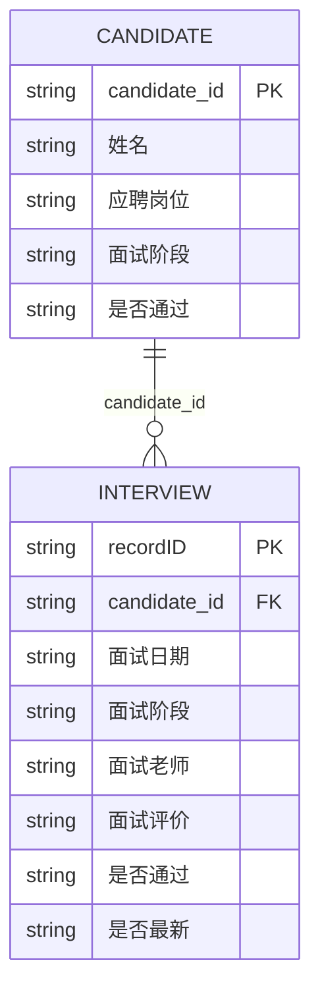
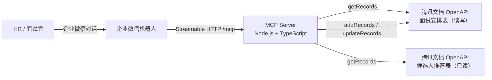

# 腾讯文档智能表 MCP 需求文档

> 版本：v0.1（需求确认稿）
> 日期：2026-10-30
> 场景：企业微信招聘机器人 → 腾讯文档智能表（候选人推荐表 / 面试安排表）
> 状态：待评审。文中标 **【待确认】** 的条目需要在开发前补齐。

---

## 1. 背景与目标

HR 招聘流程中的数据目前维护在腾讯文档智能表里，包含两张子表：

- **候选人推荐表**：候选人主数据与招聘进度。
- **面试安排表**：每一轮面试的安排与结果。

两张表通过 `candidate_id` 关联（一对多：一个候选人多轮面试对应多条面试安排记录）。

企业微信机器人需要一个 MCP Server，让机器人能够：

1. **查询记录**：两段式查询——不传 `candidate_id` 时（`sheetID` 传推荐表 ID）返回候选人清单用于定位 `candidate_id`；传入 `candidate_id` 时（`sheetID` 传面试安排表 ID）只返回该候选人的面试记录，并按 `candidate_id` 去重（多条安排保留最新一条作为主记录）。
2. **更新记录**：只更新面试安排表的「是否通过」「面试评价」两个字段；带规则校验与置信度判断。推荐表只读，不写。
3. **添加记录**：在面试安排表新增一条约面记录，写入「candidate_id」「姓名」「面试日期」「面试阶段」「面试老师」；带置信度判断。

### 1.1 非目标（本期不做）

- 不提供删除记录能力（`delete_records` 不在工具集内）。
- 不管理表结构（建表 / 加字段 / 改字段类型），只读写记录。
- 不做 OAuth 授权码流程和 Token 自动刷新（本期使用静态 `Access-Token`）。
- 不做 Web UI、不做候选人数据看板。
- 不做跨文档 / 多租户（单文档、两个子表）。

---

## 2. 需求确认记录

以下为已与需求方确认的决策，作为后续开发的依据：

| # | 决策点 | 结论 |
|---|--------|------|
| 1 | 查询模式与去重 | 不传 `candidate_id`（`sheetID` 传推荐表 ID）→ 返回全部候选人用于定位 ID；传 `candidate_id`（`sheetID` 传安排表 ID）→ 只返回该候选人的记录，并按 `candidate_id` 去重（多条面试记录只输出最新一条 `recordID`，附全部 `recordIDs`）。 |
| 2 | 置信度来源 | **纯 LLM 传入**：调用方传 `confidence`（0–1），MCP 只做阈值判断，不自算置信度。 |
| 3 | 低置信度处理 | **写入并打待确认标记**，不拦截。 |
| 4 | 待确认标记落表 | **独立列**（不污染面试状态枚举）。 |
| 5 | 字段结构 | 已固定，MCP 不调用 `get_fields` 校验列是否存在；字段清单用于配置规则。 |
| 6 | 工具与表的关系 | 查询只查 `sheetID` 指定的那一张表；更新只写面试安排表；新增只写面试安排表。**候选人推荐表全程只读**。 |
| 7 | 「是否最新」列 | 是**公式列**，MCP 只读不写。 |
| 8 | 企业微信接入 | **Streamable HTTP**，MCP 以常驻服务方式部署，机器人配置 HTTP endpoint。 |
| 9 | 硬规则失败 | 也写入并标记；无法写入的字段跳过，原因写入待确认说明。唯一例外：找不到更新目标记录时不写入。 |
| 10 | 凭证管理 | `Access-Token` / `Client-Id` / `Open-Id` 从服务端环境变量读取；`fileID` / `sheetID` 由机器人按次传入且**必填**，不设环境变量默认值；推荐表 ID 仅新增工具校验用，取 `recommendSheetID` 或环境变量 `RECOMMEND_SHEET_ID`。 |
| 11 | 工具接口风格 | 入参/出参尽量沿用腾讯文档官方结构（`fileID`/`sheetID`、`getRecords`/`updateRecords`/`addRecords`、`ret`/`msg`/`data`）；业务扩展只放在顶层少量字段和 `mcp` 对象。 |
| 12 | 推荐表只读 | 推荐表的「面试阶段」「是否通过」是公式列，`candidate_id` 是自增列，MCP 均不写；推荐表只用于查询候选人、校验姓名。 |
| 13 | 更新字段范围 | 更新工具只接受 `是否通过`、`面试评价` 两个业务字段（外加 MCP 管理的 `待确认说明`）；其他字段拒绝。 |
| 14 | 新增字段范围 | 新增工具只接受 `candidate_id`、`姓名`、`面试日期`、`面试阶段`、`面试老师` 五个业务字段（外加 MCP 管理的 `待确认说明`）；其他字段拒绝。 |

---

## 3. 数据模型

### 3.1 候选人推荐表（Recommend Sheet）

| 字段 | 类型（推断） | MCP 读 | MCP 写 | 说明 |
|------|--------------|--------|--------|------|
| `candidate_id` | 文本 | ✅ | ❌ | 主键，**自增，只读** |
| 姓名 | 文本 | ✅ | ❌ | 查询摘要、校验用 |
| 应聘部门 | 文本 / 单选 | ✅ | ❌ | 摘要 |
| 应聘岗位 | 文本 / 单选 | ✅ | ❌ | 摘要 |
| 推荐日期 | 日期 | ✅ | ❌ | 摘要 |
| 推荐语 | 文本 | ✅ | ❌ | 摘要 |
| 毕业院校 | 文本 | ✅ | ❌ | 摘要 |
| 专业 | 文本 | ✅ | ❌ | 摘要 |
| 工作年限 | 数字 / 文本 | ✅ | ❌ | 摘要，类型 **【待确认】** |
| 简历 | 附件 / 超链接 | ✅ | ❌ | 只读 |
| 招聘渠道 | 单选 / 文本 | ✅ | ❌ | 摘要 |
| 面试阶段 | 单选 / 公式 | ✅ | ❌ | **公式计算，只读** |
| 是否通过 | 单选 / 公式 | ✅ | ❌ | **公式计算，只读** |
| offer发放 | **【待确认】** | ✅ | ❌ | 只读 |

> 推荐表**全程只读**：`candidate_id` 自增，`面试阶段` / `是否通过` 由公式计算，MCP 均不写。

### 3.2 面试安排表（Interview Sheet）

| 字段 | 类型（推断） | MCP 读 | MCP 写 | 说明 |
|------|--------------|--------|--------|------|
| `candidate_id` | 文本 | ✅ | ✅（新增） | 关联键；新增时写入 |
| 姓名 | 文本 | ✅ | ✅（新增） | 新增时写入；可用推荐表校验 |
| 面试日期 | 日期 | ✅ | ✅（新增） | 毫秒时间戳字符串 |
| 面试阶段 | 单选 | ✅ | ✅（新增） | 新增时写入 |
| 面试老师 | 文本 / 成员 | ✅ | ✅（新增） | 若为「成员」字段需 userID 映射 **【待确认】** |
| 面试评价 | 文本 | ✅ | ✅（更新） | 更新时写入 |
| 是否通过 | 单选 | ✅ | ✅（更新） | 更新时写入 |
| 面评表 | 附件 / 超链接 | ✅ | ❌ | 只读 |
| 是否最新 | 公式 | ✅ | ❌ | **公式列，只读** |
| 待确认说明 | 文本（**需新增列**） | ✅ | ✅（新增/更新） | 低置信 / 规则失败标记 |

### 3.3 关系



### 3.4 前置改造

**需要在面试安排表中新增一列**（推荐表不需要加列）：

- 列名：`待确认说明`
- 类型：文本（多行文本更佳）
- 用途：当置信度低于阈值或规则校验失败时写入原因；空值表示「无需人工确认」。
- 若表格不允许新增列，退化方案：写入「面试评价」末尾的机器标记（如 `[MCP待确认:...]`），但会污染面评正文，不推荐。

---

## 4. 总体方案

### 4.1 架构



### 4.2 技术选型

| 项 | 选择 | 理由 |
|----|------|------|
| 运行时 | Node.js 20+ / TypeScript | 官方 `@modelcontextprotocol/sdk` 支持完善，Streamable HTTP 开箱即用 |
| MCP SDK | `@modelcontextprotocol/sdk` | 官方维护 |
| 传输 | Streamable HTTP（单端点 `/mcp`，无状态模式） | 企业微信机器人可直接配置 HTTP endpoint；无状态便于重启与水平扩展 |
| HTTP 框架 | Express（或 SDK 内置 Node adapter） | 轻量、快速实现 |
| 部署 | Docker + 反向代理（Nginx / Caddy）HTTPS | 企业微信要求公网可访问的 HTTPS 地址 |
| 日志 | `pino` JSON 结构化日志 | 审计与排障 |
| 测试 | `vitest` + nock（Mock 腾讯文档 API） | 覆盖规则与分页 |

> 说明：如企业微信机器人实际只支持 SSE，则在同一服务上补一个 `/sse` 端点，业务代码不变。**【待确认：企微机器人 MCP 配置支持的传输协议与鉴权头】**

### 4.3 工具清单

一个 MCP Server，暴露三个工具：

| 工具名 | 中文名 | 对应官方接口 | 类型 | 是否写表 |
|--------|--------|--------------|------|----------|
| `query_records` | 查询记录 | `get_records`（`getRecords`） | 只读 | 否 |
| `update_interview_record` | 更新面试记录 | `update_records`（`updateRecords`） | 写 | 是（仅面试安排表） |
| `add_interview_record` | 新增面试安排 | `add_records`（`addRecords`） | 写 | 是（仅面试安排表） |

工具注解：

- `query_records`：`readOnlyHint: true`
- `update_interview_record` / `add_interview_record`：`readOnlyHint: false`、`destructiveHint: false`、`idempotentHint: true`（有重复检测）

### 4.4 接口对齐原则

1. **路径参数沿用官方**：工具要求 `fileID`、`sheetID` **必填**，与官方路径一致；MCP 不推断表角色。
2. **请求体沿用官方**：工具入参直接使用 `getRecords` / `updateRecords` / `addRecords`，字段名与官方完全一致。
3. **返回体沿用官方**：工具出参保留 `ret` / `msg` / `data.<接口名>`；业务信息只放在额外的 `mcp` 对象。
4. **值格式沿用官方**：`values` 完全采用官方格式（文本数组、单选 `[{text}]`、日期毫秒时间戳等，见 5.3），MCP 不发明新格式。
5. **业务扩展最小化**：只增加顶层 `candidate_id`、`confidence`、`dry_run`、`options`，以及输出 `mcp`；不改变官方字段的含义。
6. **业务后处理显式化**：去重、规则校验、待确认标记、推荐表只读校验都在文档与 `mcp` 中说明，不隐藏在请求字段里。

---

## 5. 腾讯文档 OpenAPI 接入规范

### 5.1 通用请求

| 项 | 值 |
|----|----|
| Base URL | `https://docs.qq.com/openapi/smartbook/v2/files/{fileID}/sheets/{sheetID}` |
| Method | `POST` |
| Content-Type | `application/json` |
| 鉴权 Header | `Access-Token`、`Client-Id`、`Open-Id` |
| 响应 | `{"ret": 0, "msg": "Succeed", "data": {...}}`，`ret != 0` 为业务错误 |

三个接口共用同一个 URL，靠请求体里的根键区分：

```json
{"getRecords":    { "offset": 0, "limit": 100 }}
{"updateRecords": { "records": [ { "recordID": "rXXX", "values": { ... } } ] }}
{"addRecords":    { "records": [ { "values": { ... } } ] }}
```

### 5.2 查询分页

- `limit` 最大 **100**；不传或传 0 时最多返回 100 条。
- 用 `offset` + `hasMore` + `next` 翻页，直到 `hasMore = false`。
- 建议传 `fieldTitles` 只取需要的列，降低响应体积：
  - 推荐表：`["candidate_id","姓名","应聘岗位","面试阶段","是否通过","推荐日期","offer发放"]`
  - 安排表：`["candidate_id","姓名","面试日期","面试阶段","面试老师","面试评价","是否通过","是否最新"]`
- 接口**不支持服务端条件过滤**，按 `candidate_id` 查询只能翻页拉取后在服务端过滤。

### 5.3 字段值序列化

| 字段类型 | 写入格式 | 读取格式 |
|----------|----------|----------|
| 文本 | `[{"type":"text","text":"内容"}]` | 同左，可能多个片段 |
| 数字 | `123` | `123` |
| 复选框 | `true` / `false` | 同左 |
| 日期 | 毫秒时间戳字符串，如 `"1640150219265"` | 同左 |
| 单选 | `[{"text":"选项值"}]`（OptionValue） | 同左 |
| 多选 | `[{"text":"A"},{"text":"B"}]` | 同左 |
| 超链接 | `[{"type":"url","text":"腾讯文档","link":"https://docs.qq.com"}]` | 同左 |
| 图片 | `[{"imageID":"..."}]` | `[{"id","title","imageUrl"}]` |
| 电话 / 邮箱 | 字符串 | 字符串 |
| 进度 | 数字 | 数字 |

注意事项：

- 单选项必须存在于字段的选项列表中；若表格关闭了「快速新增选项」，写入不存在的选项会失败。
- 清空文本/单选：写入空数组 `[]`。
- **不能写**创建时间、最后编辑时间、创建人、最后编辑人；「是否最新」（安排表）、「面试阶段」「是否通过」（推荐表）为公式列，推荐表 `candidate_id` 为自增列，均不写。
- 时区统一按 `Asia/Shanghai` 解析与格式化日期。
- 本文中的 `TencentValue` 指上表中对应字段类型的任一官方 JSON 值；`values` 的 key 是字段标题（`fieldTitle`），不是字段 ID。

### 5.4 频率限制与重试

| 维度 | 限制 |
|------|------|
| 单文档（fileID） | 150 次 / 分钟 |
| 单用户（openID） | 300 次 / 分钟 |

客户端策略：

- 令牌桶：按 fileID 限制 **120 次/分钟**、按 openID 限制 **250 次/分钟**，预留余量。
- 单请求超时 10s；对 429 / 5xx / 网络错误做 2 次指数退避重试（500ms、1500ms）。
- `ret != 0` 的业务错误不重试，直接映射为工具错误。
- 全量扫描 1000 条约 10 次请求/表，仍在限额内；超过 `MAX_SCAN_RECORDS` 时提前截断并返回提示。

### 5.5 常见业务错误码

| ret | 含义 | MCP 处理 |
|-----|------|----------|
| `10313` | Access-Token 为空 | `AUTH_FAILED`，提示检查环境变量 |
| `10302` | Client-Id 错误 | `AUTH_FAILED` |
| `10303` | Open-Id 错误 | `AUTH_FAILED` |
| `37019` | Token 校验失败 / 过期 | `AUTH_FAILED`，提示重新获取 Token |
| 其他 | 业务错误 | `API_ERROR`，透传 `ret` / `msg` |
| HTTP 429 | 触发频控 | `RATE_LIMITED`，退避后重试 |

---

## 6. 配置设计

### 6.1 环境变量

| 变量 | 必填 | 默认 | 说明 |
|------|------|------|------|
| `ACCESS_TOKEN` | 是 | — | 腾讯文档 Access-Token |
| `CLIENT_ID` | 是 | — | 应用 Client-Id |
| `OPEN_ID` | 是 | — | 用户 Open-Id |
| `RECOMMEND_SHEET_ID` | 否 | — | 推荐表 sheetID；新增工具未传 `recommendSheetID` 时用于候选人校验 |
| `CONFIDENCE_THRESHOLD` | 否 | `0.8` | 置信度阈值（0–1） |
| `MAX_SCAN_RECORDS` | 否 | `1000` | 单次查询最大扫描记录数 |
| `PAGE_SIZE` | 否 | `100` | 分页大小，最大 100 |
| `HTTP_PORT` | 否 | `3000` | 服务端口 |
| `MCP_AUTH_TOKEN` | 否 | 空 | 保护 `/mcp` 的 Bearer Token；为空则不校验 |
| `ALLOW_ORPHAN_ADD` | 否 | `true` | 候选人不在推荐表时是否仍写入安排表（写入并标记） |
| `PENDING_COLUMN` | 否 | `待确认说明` | 待确认标记列名 |
| `MARK_PENDING` | 否 | `true` | 是否写入/清空待确认说明（可被 `options.mark_pending` 覆盖） |
| `LOG_LEVEL` | 否 | `info` | 日志级别 |

> `fileID` / `sheetID` 由工具入参显式提供，不设环境变量默认值；`RECOMMEND_SHEET_ID` 只用于新增工具的候选人校验。

> `ALLOW_ORPHAN_ADD`、`MARK_PENDING` 是默认值，可被工具 `options.allow_orphan` / `options.mark_pending` 按次覆盖；`CONFIDENCE_THRESHOLD`、`MAX_SCAN_RECORDS` 只由环境变量控制。

### 6.2 fileID / sheetID 的传入方式

需求方说明「fileID / sheetID 会直接给机器人」，因此路径参数一律由工具入参显式提供，MCP **不做表角色推断**。

- 三个工具都要求 `fileID`、`sheetID` **必填**。
- 查询工具：`sheetID` 是要查询的子表 ID。典型用法：不带 `candidate_id` 时传推荐表 ID；带 `candidate_id` 时传面试安排表 ID。
- 更新工具：`sheetID` 是面试安排表 ID；不访问推荐表。
- 新增工具：`sheetID` 是面试安排表 ID；另接受 `recommendSheetID`（推荐表 ID）用于候选人校验，不传时读环境变量 `RECOMMEND_SHEET_ID`。
- 若新增工具缺少 `recommendSheetID` 和环境变量：跳过候选人校验并返回 `mcp.warnings`；若 `options.allow_orphan=false`，返回 `CONFIG_MISSING`。

### 6.3 列名映射

列标题写死为配置项（不调用 `get_fields` 校验），默认值如下：

| 配置键 | 默认列名 |
|--------|----------|
| `FIELD_CANDIDATE_ID` | `candidate_id` |
| `FIELD_NAME` | `姓名` |
| `FIELD_POSITION` | `应聘岗位` |
| `FIELD_RECOMMEND_STAGE` | `面试阶段` |
| `FIELD_RECOMMEND_RESULT` | `是否通过` |
| `FIELD_INTERVIEW_DATE` | `面试日期` |
| `FIELD_INTERVIEW_STAGE` | `面试阶段` |
| `FIELD_INTERVIEWER` | `面试老师` |
| `FIELD_FEEDBACK` | `面试评价` |
| `FIELD_INTERVIEW_RESULT` | `是否通过` |
| `FIELD_IS_LATEST` | `是否最新` |
| `FIELD_PENDING` | `待确认说明` |

> 列标题如与实际表不一致，改环境变量即可，不改代码。

业务含义与实际 `values` 键的对应关系：

| 业务含义 | `values` 中的键（默认） |
|----------|--------------------------|
| 候选人 ID | `candidate_id` |
| 面试结果 | `是否通过` |
| 面评 | `面试评价` |
| 面试阶段 | `面试阶段` |
| 面试老师 | `面试老师` |
| 面试日期 | `面试日期` |
| 人工确认标记 | `待确认说明` |

---

## 7. 工具一：`query_records` 查询记录

### 7.1 用途与接口对齐

`query_records` 对应腾讯文档官方的 **查询记录** 接口（`getRecords`）。

- 入参保留官方路径参数 `fileID` / `sheetID` 和官方请求体 `getRecords`，字段名、类型、含义与官方一致。
- `fileID` / `sheetID` **必填**，由调用方明确指定要查哪张表；MCP 不推断表角色。
- 出参保留官方 `ret` / `msg` / `data.getRecords` 结构；业务信息只放在额外的 `mcp` 对象里。
- 业务扩展只有两项：`candidate_id`（候选人过滤 + 去重）和 `options.max_records`（扫描上限）。不传 `candidate_id` 时是近乎原样的官方查询。

**典型业务用法**：

- 不带 `candidate_id`、`sheetID` 传推荐表 ID → 找候选人的 `candidate_id`；
- 带 `candidate_id`、`sheetID` 传面试安排表 ID → 取该候选人的 `recordID`（多条安排去重后取最新一条）。

### 7.2 输入

```ts
interface QueryRecordsInput {
  /** 文档 ID，必填 */
  fileID: string;

  /** 子表 ID，必填。
   *  业务上：不带 candidate_id 时通常传推荐表 ID；
   *  带 candidate_id 时通常传面试安排表 ID。
   */
  sheetID: string;

  /** 官方 GetRecordsRequest，字段与官方一致 */
  getRecords: {
    /** 视图 ID，可选 */
    viewID?: string;
    /** 只查指定记录 ID，可选 */
    recordIDs?: string[];
    /** 只返回指定字段，可选；不传返回全部字段 */
    fieldTitles?: string[];
    /** 排序，可选 */
    sort?: Array<{ fieldTitle: string; desc?: boolean }>;
    /** 偏移量，默认 0 */
    offset?: number;
    /** 分页大小，默认 100，最大 100 */
    limit?: number;
  };

  /** 业务扩展：候选人 ID。
   *  不传 → 在 sheetID 指定的表内按官方分页原样返回；
   *  传 → 在 sheetID 指定的表内筛选该候选人并去重。
   */
  candidate_id?: string;

  /** 业务扩展：仅 candidate_id 模式生效 */
  options?: {
    /** 最大扫描记录数，默认 1000，上限 5000 */
    max_records?: number;
  };
}
```

#### 输入字段含义

| 字段 | 来源 | 必填 | 默认 | 含义 |
|------|------|------|------|------|
| `fileID` | 官方路径参数 | 是 | — | 文档唯一标识 |
| `sheetID` | 官方路径参数 | 是 | — | 要查询的子表 ID；推荐表 / 安排表由调用方明确指定 |
| `getRecords` | 官方请求体 | 是 | — | 查询参数容器 |
| `getRecords.viewID` | 官方 | 否 | — | 视图 ID |
| `getRecords.recordIDs` | 官方 | 否 | — | 记录 ID 数组 |
| `getRecords.fieldTitles` | 官方 | 否 | 全部字段 | 字段标题数组 |
| `getRecords.sort` | 官方 | 否 | — | 排序数组，`desc` 默认 `false` |
| `getRecords.offset` | 官方 | 否 | `0` | 偏移量 |
| `getRecords.limit` | 官方 | 否 | `100` | 每页条数，最大 100 |
| `candidate_id` | MCP 扩展 | 否 | — | 候选人 ID；有值时在 `sheetID` 表内过滤并去重 |
| `options.max_records` | MCP 扩展 | 否 | env `MAX_SCAN_RECORDS`（默认 `1000`） | candidate_id 模式的最大扫描条数 |

> `mcp.mode` 是业务语义：不传 `candidate_id` 时为 `recommend`，传 `candidate_id` 时为 `interview`；MCP 不校验 `sheetID` 实际属于哪张表。

### 7.3 处理逻辑

**模式 A：不传 `candidate_id`（官方直通）**

```text
1. 直接使用入参 fileID / sheetID（业务上应为推荐表）
2. 原样调用 POST /openapi/smartbook/v2/files/{fileID}/sheets/{sheetID}
   body = { "getRecords": { viewID, recordIDs, fieldTitles, sort, offset, limit } }
3. 原样返回腾讯文档响应
4. mcp.mode = "recommend"；不做去重、不额外扫描
```

**模式 B：传 `candidate_id`（候选人去重）**

```text
1. 直接使用入参 fileID / sheetID（业务上应为面试安排表）
2. 内部分页扫描（每页 limit=100，直到 hasMore=false 或达到 max_records）
   - 每次请求带 fieldTitles；若调用方传了 recordIDs，则只扫这些记录
3. 按 values[candidate_id] === 入参 candidate_id 过滤
4. 按 candidate_id 去重：
   a. 主记录：是否最新=是 → 否则 面试日期最大 → 再否则 createTime 最大
   b. data.getRecords.records = [主记录]
   c. mcp.dedup.allRecordIDs = 全部匹配记录 ID（按面试日期倒序）
   d. mcp.dedup.duplicateCount = 去重前条数
5. data.getRecords.total = 去重后条数（0 或 1）
   data.getRecords.hasMore = false
   data.getRecords.next = 0
6. mcp.mode = "interview"
```

> **模式 B 的 offset / limit 说明**：为了先拿到该候选人的全部记录再选最新，工具会内部翻页扫描；调用方传的 `getRecords.offset` / `getRecords.limit` **不用于官方分页**（`limit` 仅作为内部页大小参考，最大 100）。这一点与官方接口行为不同，工具描述中必须写明。

### 7.4 输出

```ts
interface QueryRecordsOutput {
  /** 0=成功；非 0=腾讯文档业务错误；-1=MCP 参数/配置错误 */
  ret: number;
  msg: string;
  data: {
    getRecords: {
      hasMore: boolean;
      next: number;
      total: number;
      records: Array<{
        recordID: string;
        createTime: string;
        updateTime: string;
        values: Record<string, TencentValue>;
      }>;
    };
  };
  mcp: {
    mode: "recommend" | "interview";
    candidate_id?: string;
    dedup?: {
      applied: boolean;
      primaryRecordID: string;
      allRecordIDs: string[];
      duplicateCount: number;
    };
    scanned: number;
    truncated: boolean;
    warnings: string[];
  };
}
```

#### 输出字段含义

| 字段 | 来源 | 含义 |
|------|------|------|
| `ret` | 官方 | 0 成功；非 0 为腾讯文档业务错误码；-1 为 MCP 侧错误 |
| `msg` | 官方 | 成功为 `Succeed`，失败为错误描述 |
| `data.getRecords.hasMore` | 官方 | 是否还有下一页（模式 B 固定 `false`） |
| `data.getRecords.next` | 官方 | 下一页偏移量（模式 B 固定 `0`） |
| `data.getRecords.total` | 官方 / MCP | 模式 A 为官方总数；模式 B 为去重后条数 |
| `data.getRecords.records[].recordID` | 官方 | 记录 ID |
| `data.getRecords.records[].createTime` | 官方 | 创建时间（毫秒时间戳字符串） |
| `data.getRecords.records[].updateTime` | 官方 | 最后编辑时间（毫秒时间戳字符串） |
| `data.getRecords.records[].values` | 官方 | 字段值，key 为字段标题，value 见 5.3 |
| `mcp.mode` | MCP | `recommend`（查推荐表）/ `interview`（查安排表并去重） |
| `mcp.candidate_id` | MCP | 模式 B 回显的候选人 ID |
| `mcp.dedup.applied` | MCP | 是否执行了 candidate_id 去重 |
| `mcp.dedup.primaryRecordID` | MCP | 去重后的主记录 ID |
| `mcp.dedup.allRecordIDs` | MCP | 去重前该候选人的全部记录 ID |
| `mcp.dedup.duplicateCount` | MCP | 去重前记录条数 |
| `mcp.scanned` | MCP | 实际扫描的原始记录条数 |
| `mcp.truncated` | MCP | 是否因 `max_records` 截断 |
| `mcp.warnings` | MCP | 告警（如推荐表候选人有重复） |

### 7.5 示例

**模式 A：不传 `candidate_id`**

```json
{
  "fileID": "300000000$AAAAAAAAA",
  "sheetID": "recSheet01",
  "getRecords": {
    "fieldTitles": ["candidate_id", "姓名", "应聘岗位", "面试阶段", "是否通过", "推荐日期"],
    "offset": 0,
    "limit": 1
  }
}
```

```json
{
  "ret": 0,
  "msg": "Succeed",
  "data": {
    "getRecords": {
      "hasMore": true,
      "next": 1,
      "total": 120,
      "records": [
        {
          "recordID": "rRec01",
          "createTime": "1760000000000",
          "updateTime": "1760000000000",
          "values": {
            "candidate_id": [{ "type": "text", "text": "C2026001" }],
            "姓名": [{ "type": "text", "text": "张三" }],
            "应聘岗位": [{ "text": "后端工程师" }],
            "面试阶段": [{ "text": "待面试" }],
            "是否通过": [{ "text": "待定" }],
            "推荐日期": "1760000000000"
          }
        }
      ]
    }
  },
  "mcp": {
    "mode": "recommend",
    "scanned": 1,
    "truncated": false,
    "warnings": []
  }
}
```

**模式 B：传 `candidate_id`，安排表中有 3 条记录**

```json
{
  "fileID": "300000000$AAAAAAAAA",
  "sheetID": "intSheet01",
  "candidate_id": "C2026001",
  "getRecords": {
    "fieldTitles": ["candidate_id", "姓名", "面试日期", "面试阶段", "面试老师", "是否通过", "面试评价", "是否最新"]
  }
}
```

```json
{
  "ret": 0,
  "msg": "Succeed",
  "data": {
    "getRecords": {
      "hasMore": false,
      "next": 0,
      "total": 1,
      "records": [
        {
          "recordID": "rInterview03",
          "createTime": "1760000000000",
          "updateTime": "1793253600000",
          "values": {
            "candidate_id": [{ "type": "text", "text": "C2026001" }],
            "姓名": [{ "type": "text", "text": "张三" }],
            "面试日期": "1793253600000",
            "面试阶段": [{ "text": "复试" }],
            "面试老师": [{ "type": "text", "text": "李老师" }],
            "是否通过": [{ "text": "待定" }],
            "面试评价": [{ "type": "text", "text": "……" }],
            "是否最新": [{ "text": "是" }]
          }
        }
      ]
    }
  },
  "mcp": {
    "mode": "interview",
    "candidate_id": "C2026001",
    "dedup": {
      "applied": true,
      "primaryRecordID": "rInterview03",
      "allRecordIDs": ["rInterview03", "rInterview02", "rInterview01"],
      "duplicateCount": 3
    },
    "scanned": 356,
    "truncated": false,
    "warnings": []
  }
}
```

**模式 B：安排表中无该候选人**

```json
{
  "ret": 0,
  "msg": "Succeed",
  "data": {
    "getRecords": {
      "hasMore": false,
      "next": 0,
      "total": 0,
      "records": []
    }
  },
  "mcp": {
    "mode": "interview",
    "candidate_id": "C2026999",
    "dedup": {
      "applied": true,
      "primaryRecordID": "",
      "allRecordIDs": [],
      "duplicateCount": 0
    },
    "scanned": 356,
    "truncated": false,
    "warnings": ["该候选人在面试安排表中暂无记录，可调用 add_interview_record 约面。"]
  }
}
```

### 7.6 与官方接口的差异

| 项 | 官方 `get_records` | 本工具 |
|----|--------------------|--------|
| 路径参数 | `fileID` / `sheetID` | 同名且**都必填**；不推断表角色 |
| 请求体 | `getRecords` | 同名、同字段 |
| 返回体 | `ret` / `msg` / `data.getRecords` | 同名；额外增加 `mcp` |
| `candidate_id` | 无 | 有值时在 `sheetID` 指定的表内过滤并去重，不切换表 |
| `offset` / `limit` | 官方分页 | 模式 A 完全一致；模式 B 忽略（内部全表扫描） |
| `total` | 官方总数 | 模式 A 一致；模式 B 为去重后条数 |
| 去重 | 无 | 模式 B 按 `candidate_id` 取最新一条，附全部 `recordID` |

### 7.7 异常

| 场景 | 返回 |
|------|------|
| `fileID` / `sheetID` 缺失 | `ret=-1`，`mcp.error.code=INVALID_ARGUMENT` |
| `ACCESS_TOKEN` / `CLIENT_ID` / `OPEN_ID` 缺失 | `ret=-1`，`mcp.error.code=CONFIG_MISSING` |
| Token 无效/过期 | 透传官方 `ret`（如 37019），`mcp.error.code=AUTH_FAILED` |
| 扫描超过 `max_records` | `ret=0`，`mcp.truncated=true` |
| 查询结果为空 | `ret=0`，`records=[]` |
| 表中无该候选人 | `ret=0`，`total=0`，`mcp.warnings` 提示可约面 |

---

## 8. 工具二：`update_interview_record` 更新面试记录

### 8.1 用途与接口对齐

`update_interview_record` 对应腾讯文档官方的 **更新记录** 接口（`updateRecords`），只写**面试安排表**。

- 业务字段范围固定为两个：`是否通过`、`面试评价`。
- 候选人推荐表**只读**：其「面试阶段」「是否通过」是公式列，`candidate_id` 是自增列，均不写。
- 入参保留官方路径参数 `fileID` / `sheetID` 和官方请求体 `updateRecords`；`records[].recordID`、`records[].values` 的字段名与格式与官方一致。
- 出参保留官方 `ret` / `msg` / `data.updateRecords`；业务信息放在额外的 `mcp` 对象。
- 业务扩展：`confidence`、`dry_run`、`options.mark_pending`。

### 8.2 输入

```ts
interface UpdateInterviewRecordInput {
  /** 文档 ID，必填 */
  fileID: string;

  /** 面试安排表 ID，必填 */
  sheetID: string;

  /** 官方 UpdateRecordsRequest */
  updateRecords: {
    records: Array<{
      /** 记录 ID，必填；从 query_records 获取 */
      recordID: string;
      /** 只允许 是否通过、面试评价；待确认说明由 MCP 管理 */
      values: Record<string, TencentValue>;
    }>;
  };

  /** 业务扩展：LLM 置信度，0–1；缺失按 0 处理 */
  confidence: number;

  /** 业务扩展：只校验、不写入 */
  dry_run?: boolean;

  /** 业务扩展 */
  options?: {
    /** 是否写/清空待确认说明，默认 true */
    mark_pending?: boolean;
  };
}
```

#### 输入字段含义

| 字段 | 来源 | 必填 | 默认 | 含义 |
|------|------|------|------|------|
| `fileID` | 官方路径参数 | 是 | — | 文档唯一标识 |
| `sheetID` | 官方路径参数 | 是 | — | 面试安排表 ID |
| `updateRecords` | 官方请求体 | 是 | — | 更新请求容器 |
| `updateRecords.records[].recordID` | 官方 | 是 | — | 要更新的记录 ID |
| `values["是否通过"]` | 官方字段 | 否* | — | 面试结果，单选数组，如 `[{"text":"通过"}]` |
| `values["面试评价"]` | 官方字段 | 否* | — | 面评正文，文本数组 |
| `values["待确认说明"]` | MCP 专用 | 否 | — | 由 MCP 写入/清空；调用方传值会被覆盖 |
| `values` 中其他键 | — | 否 | — | **不允许**，返回 `INVALID_ARGUMENT` |
| `confidence` | MCP 扩展 | 是 | 0（缺失时） | LLM 置信度，0–1 |
| `dry_run` | MCP 扩展 | 否 | `false` | 只校验、不落库 |
| `options.mark_pending` | MCP 扩展 | 否 | `true` | 是否写入/清空待确认说明 |

\* `是否通过` 与 `面试评价` **至少提供一个**；两者都没有时返回 `INVALID_ARGUMENT`。

> `values` 完全采用官方格式：文本 `[{"type":"text","text":"..."}]`，单选 `[{"text":"通过"}]`。MCP 不发明新格式。`面试阶段`、`面试老师`、`面试日期` 等字段不属于更新范围，传了会被拒绝。

### 8.3 处理逻辑

```text
1. 校验 fileID / sheetID、updateRecords.records 非空、每条有 recordID
2. 校验 values 的 key 只允许 {是否通过, 面试评价, 待确认说明}
   - 出现其他字段 → INVALID_ARGUMENT，不写入
3. 校验 是否通过 / 面试评价 至少有一个
4. 归一化与校验：
   a. 是否通过：取 [{text}] 的 text，按别名表归一化
      - 无法归一化 → 从 values 移除该字段，记录 hard rule
   b. 面试评价：把数组里的 text 片段拼成完整字符串
      - 为空或少于 10 字 → 移除该字段 + hard rule
      - 超过 5000 字 → 截断到 5000 + hard rule
5. 计算 pending：confidence < CONFIDENCE_THRESHOLD 或存在任一 hard/soft rule
6. 若 options.mark_pending：
   - pending=true  → values[PENDING_COLUMN] = [{"type":"text","text":"[MCP待确认] ..."}]
   - pending=false → values[PENDING_COLUMN] = []（清空）
7. 若去除 PENDING_COLUMN 后 values 为空 → NO_WRITABLE_FIELDS，不调用官方接口
8. dry_run=true → 不调用官方接口，返回 mcp.status="dry_run"
9. 调官方 updateRecords：body = { "updateRecords": { "records": [...] } }
10. 返回官方响应 + mcp
```

**批量说明**：`updateRecords.records` 支持多条，每条独立校验与标记；本工具不访问推荐表，因此不存在跨表同步。

### 8.4 规则校验

| ID | 级别 | 校验内容 | 失败处理 |
|----|------|----------|----------|
| H01 | 硬 | `recordID` 非空、`updateRecords.records` 非空 | 不调用，`INVALID_ARGUMENT` |
| H02 | 硬 | `values` 只含 `是否通过`、`面试评价`、`待确认说明` | 不调用，`INVALID_ARGUMENT` |
| H03 | 硬 | 目标记录存在（官方返回成功） | 透传官方错误，不写入 |
| H04 | 硬 | `是否通过` 归一化后 ∈ `{通过,不通过,待定}` | 从 values 移除该字段 + 标记 |
| H05 | 硬 | `面试评价` 非空、长度 10–5000 | 为空/过短 → 移除 + 标记；过长 → 截断 + 标记 |
| S01 | 软 | `confidence >= CONFIDENCE_THRESHOLD`（默认 0.8） | 写 + 标记 |
| S02 | 软 | 结果与面评语义一致（正向/负向关键词冲突） | 写 + 标记 |
| S03 | 软 | 面评中出现其他候选人姓名 | 写 + 标记（MVP 可关闭） |
| S04 | 软 | `confidence` 缺失或不在 0–1 | 按 0 处理 + 标记 |

归一化与文本提取：

```text
select(values["是否通过"]) = values["是否通过"][0]?.text
text(values["面试评价"]) = values["面试评价"].map(v => v.text).join("")
```

别名表（可配置）：通过 ← 通过 / 是 / 过 / pass / 同意录用；不通过 ← 不通过 / 否 / 未通过 / 淘汰 / 拒绝 / fail；待定 ← 待定 / 待确认 / 未知 / 待面试。

### 8.5 输出

```ts
interface UpdateInterviewRecordOutput {
  /** 0=成功；非 0=腾讯文档业务错误；-1=MCP 参数/配置错误 */
  ret: number;
  msg: string;
  data: {
    updateRecords: {
      records: Array<{
        recordID: string;
        values: Record<string, TencentValue>;
      }>;
    };
  };
  mcp: {
    status:
      | "updated"
      | "updated_pending_confirmation"
      | "dry_run"
      | "error";
    confidence: number;
    threshold: number;
    pending: boolean;
    rules: Array<{
      id: string;
      level: "hard" | "soft";
      field?: string;
      message: string;
    }>;
    sanitized: boolean;
    warnings: string[];
    error?: {
      code: string;
      message: string;
      hint?: string;
    };
  };
}
```

#### 输出字段含义

| 字段 | 来源 | 含义 |
|------|------|------|
| `ret` / `msg` | 官方 | 官方业务码与描述；MCP 侧错误为 `ret=-1` |
| `data.updateRecords.records[]` | 官方 | 官方返回的更新后记录（含 `recordID` 与 `values`） |
| `mcp.status` | MCP | `updated` 正常；`updated_pending_confirmation` 已写但待确认；`dry_run` 未写；`error` 未写 |
| `mcp.confidence` | MCP | 回显置信度 |
| `mcp.threshold` | MCP | 当前阈值 |
| `mcp.pending` | MCP | 是否打待确认标记 |
| `mcp.rules[]` | MCP | 命中的规则：`id`、`level`、`field`、`message` |
| `mcp.sanitized` | MCP | values 是否被修改（移除非法字段/截断/加标记） |
| `mcp.warnings[]` | MCP | 非阻断告警 |
| `mcp.error` | MCP | MCP 侧错误详情（`code`/`message`/`hint`） |

### 8.6 示例

输入：

```json
{
  "fileID": "300000000$AAAAAAAAA",
  "sheetID": "intSheet01",
  "updateRecords": {
    "records": [
      {
        "recordID": "rInterview03",
        "values": {
          "是否通过": [{ "text": "通过" }],
          "面试评价": [
            { "type": "text", "text": "候选人对分布式系统理解深入，项目经验匹配，建议进入终面。" }
          ]
        }
      }
    ]
  },
  "confidence": 0.88
}
```

输出（成功）：

```json
{
  "ret": 0,
  "msg": "Succeed",
  "data": {
    "updateRecords": {
      "records": [
        {
          "recordID": "rInterview03",
          "values": {
            "是否通过": [{ "text": "通过" }],
            "面试评价": [{ "type": "text", "text": "候选人对分布式系统理解深入……" }],
            "待确认说明": []
          }
        }
      ]
    }
  },
  "mcp": {
    "status": "updated",
    "confidence": 0.88,
    "threshold": 0.8,
    "pending": false,
    "rules": [],
    "sanitized": true,
    "warnings": []
  }
}
```

低置信度时 `mcp.status="updated_pending_confirmation"`、`mcp.pending=true`，`待确认说明` 写入原因，例如：

```text
[MCP待确认] confidence=0.62 (<0.80); rules=S01,H04; detail=面试结果"过"无法归一化; at=2026-10-30T14:05:00+08:00
```

### 8.7 与官方接口的差异

| 项 | 官方 `update_records` | 本工具 |
|----|----------------------|--------|
| 路径参数 | `fileID` / `sheetID` | 同名且**都必填**（面试安排表） |
| 请求体 | `updateRecords` | 同名、同字段 |
| 返回体 | `ret` / `msg` / `data.updateRecords` | 同名；额外增加 `mcp` |
| `recordID` | 必填 | 必填；从 `query_records` 获取 |
| `values` | 任意字段 | **只允许 `是否通过`、`面试评价`**（`待确认说明` 由 MCP 管理）；其他字段拒绝 |
| `confidence` / `dry_run` / `options` | 无 | 顶层业务扩展 |
| `待确认说明` | 无 | pending 时写入，正常时清空 |
| 推荐表 | 无 | **不访问、不写入** |
| 返回状态 | 只有 `ret` | `ret` 之外用 `mcp.status` 表达待确认 |

### 8.8 异常

| 场景 | 返回 |
|------|------|
| `fileID` / `sheetID` 缺失 | `ret=-1`，`mcp.error.code=INVALID_ARGUMENT` |
| `recordID` 缺失或 `records` 为空 | `ret=-1`，`mcp.error.code=INVALID_ARGUMENT` |
| 出现 `是否通过` / `面试评价` 以外的 values 键 | `ret=-1`，`mcp.error.code=INVALID_ARGUMENT` |
| `是否通过` 与 `面试评价` 都没传 | `ret=-1`，`mcp.error.code=INVALID_ARGUMENT` |
| 记录不存在 / 无权限 | 透传官方 `ret`/`msg`，`mcp.status="error"` |
| 两个字段都无法写入 | `ret=-1`，`mcp.error.code=NO_WRITABLE_FIELDS`，不调用官方接口 |
| `dry_run=true` | `ret=0`，`mcp.status="dry_run"`，不写表 |
| Token 无效/过期 | 透传官方 `ret`，`mcp.error.code=AUTH_FAILED` |

---

## 9. 工具三：`add_interview_record` 新增面试安排

### 9.1 用途与接口对齐

`add_interview_record` 对应腾讯文档官方的 **添加记录** 接口（`addRecords`），只写**面试安排表**。

- 业务字段范围固定为五个：`candidate_id`、`姓名`、`面试日期`、`面试阶段`、`面试老师`。
- 候选人推荐表**只读**：仅用于候选人存在性与姓名校验，不写任何字段。
- 入参保留官方路径参数 `fileID` / `sheetID` 和官方请求体 `addRecords`；`records[].values` 的字段名与格式与官方一致。
- 出参保留官方 `ret` / `msg` / `data.addRecords`；业务信息放在额外的 `mcp` 对象。
- 业务扩展：`confidence`、`dry_run`、`options`（重复策略、待确认标记、孤儿记录策略）。

### 9.2 输入

```ts
interface AddInterviewRecordInput {
  /** 文档 ID，必填 */
  fileID: string;

  /** 面试安排表 ID，必填 */
  sheetID: string;

  /** 推荐表 ID，可选；仅用于候选人校验。
   *  缺省读取环境变量 RECOMMEND_SHEET_ID。
   */
  recommendSheetID?: string;

  /** 官方 AddRecordsRequest */
  addRecords: {
    records: Array<{
      /** 只允许 candidate_id / 姓名 / 面试日期 / 面试阶段 / 面试老师；
       *  待确认说明由 MCP 管理 */
      values: Record<string, TencentValue>;
    }>;
  };

  /** 业务扩展：LLM 置信度，0–1；缺失按 0 处理 */
  confidence: number;

  /** 业务扩展：只校验、不写入 */
  dry_run?: boolean;

  /** 业务扩展 */
  options?: {
    /** 重复约面策略，默认 return_existing */
    duplicate_policy?: "return_existing" | "create_anyway";
    /** 是否写待确认说明，默认 true */
    mark_pending?: boolean;
    /** 推荐表找不到候选人时是否仍写入，默认 true */
    allow_orphan?: boolean;
  };
}
```

#### 输入字段含义

| 字段 | 来源 | 必填 | 默认 | 含义 |
|------|------|------|------|------|
| `fileID` | 官方路径参数 | 是 | — | 文档唯一标识 |
| `sheetID` | 官方路径参数 | 是 | — | 面试安排表 ID |
| `recommendSheetID` | MCP 扩展 | 否 | env `RECOMMEND_SHEET_ID` | 推荐表 ID；仅用于候选人校验 |
| `addRecords` | 官方请求体 | 是 | — | 新增请求容器 |
| `values["candidate_id"]` | 官方字段（业务必填） | 是 | — | 候选人 ID，用于关联与去重 |
| `values["姓名"]` | 官方字段（业务必填） | 是* | — | 候选人姓名；推荐表可校验 |
| `values["面试日期"]` | 官方字段（业务必填） | 是* | — | 面试时间，毫秒时间戳字符串 |
| `values["面试阶段"]` | 官方字段（业务必填） | 是* | — | 面试阶段，单选，如 `[{"text":"初试"}]` |
| `values["面试老师"]` | 官方字段（业务必填） | 是* | — | 面试老师，文本 |
| `values["待确认说明"]` | MCP 专用 | 否 | — | 由 MCP 写入；调用方传值会被覆盖 |
| `values` 中其他键 | — | 否 | — | **不允许**，返回 `INVALID_ARGUMENT` |
| `confidence` | MCP 扩展 | 是 | 0（缺失时） | LLM 置信度，0–1 |
| `dry_run` | MCP 扩展 | 否 | `false` | 只校验、不落库 |
| `options.duplicate_policy` | MCP 扩展 | 否 | `return_existing` | 重复约面的处理方式 |
| `options.mark_pending` | MCP 扩展 | 否 | `true` | 是否写待确认说明 |
| `options.allow_orphan` | MCP 扩展 | 否 | `true` | 推荐表无此人时是否仍新增 |

\* 这四个字段是 **MCP 业务规则** 的必填项（不是腾讯文档 API 的必填项）。缺失时按硬规则处理：`candidate_id` 缺失直接拒绝；其余字段缺失仍可新增，但会打待确认标记。

> `values` 完全采用官方格式：文本 `[{"type":"text","text":"..."}]`，单选 `[{"text":"初试"}]`，日期 `"毫秒时间戳"`。MCP 不发明新格式。

### 9.3 处理逻辑

```text
1. 校验 fileID / sheetID、addRecords.records 非空
2. 校验 values 的 key 只允许 {candidate_id, 姓名, 面试日期, 面试阶段, 面试老师, 待确认说明}
   - 出现其他字段 → INVALID_ARGUMENT，不写入
3. 取 candidate_id = text(values["candidate_id"])
   - 为空 → INVALID_ARGUMENT，不写入
4. 归一化已知字段：
   - 面试日期：毫秒时间戳字符串；若传入 ISO/中文日期，转换为毫秒（MCP 便利，非官方格式）
   - 面试阶段：单选 [{text}]，按别名表归一化
   - 姓名 / 面试老师：文本 [{type:"text",text}]
   - 缺失或非法字段：移除 + hard rule（candidate_id 除外）
5. recommendSheetID = 入参.recommendSheetID ?? env RECOMMEND_SHEET_ID
   - 缺失 → 跳过推荐表校验，mcp.warnings 提示
   - 有 → 在推荐表按 candidate_id 查候选人：
       · 找到 → 以推荐表姓名为权威值覆盖 values["姓名"]；入参姓名不一致 → soft rule
       · 未找到：
           allow_orphan=true  → 继续新增 + pending
           allow_orphan=false → CANDIDATE_NOT_FOUND，不写入
6. 重复检测（面试安排表，按 candidate_id 扫描）：
   - 同 面试阶段 且 面试日期为同一天（或相差 < 2 小时）视为重复
   - duplicate_policy=return_existing → 不新增，data.addRecords.records 返回已有记录，
     mcp.status="duplicate"，mcp.duplicate=true
   - create_anyway → 继续新增，并打 pending 标记
7. 计算 pending：confidence < 阈值 或 任一 hard/soft rule 命中
8. 若 pending 且 mark_pending：values[PENDING_COLUMN] = 待确认说明文本
9. dry_run=true → 不调用官方接口，返回 mcp.status="dry_run"
10. 调官方 addRecords：body = { "addRecords": { "records": [ { "values": {...} } ] } }
11. 返回官方响应 + mcp
```

**批量说明**：`addRecords.records` 支持多条，每条独立校验、去重和标记；本工具只写面试安排表，不写推荐表。

### 9.4 规则校验

| ID | 级别 | 校验内容 | 失败处理 |
|----|------|----------|----------|
| A01 | 硬 | `candidate_id` 非空 | 不写入，`INVALID_ARGUMENT` |
| A02 | 硬 | `values` 只含五个业务字段 + `待确认说明` | 不写入，`INVALID_ARGUMENT` |
| A03 | 硬 | `姓名` / `面试日期` / `面试阶段` / `面试老师` 非空 | 缺失字段移除，仍新增其余字段 + 标记 |
| A04 | 硬 | `面试日期` 可解析为毫秒时间戳 | 移除日期 + 标记 |
| A05 | 硬 | `面试阶段` 归一化后 ∈ 阶段枚举 | 移除 + 标记 |
| A06 | 硬 | 候选人在推荐表存在（若 `recommendSheetID` 可用） | 按 `allow_orphan` 写入 + 标记或拒绝 |
| A07 | 软 | `confidence >= CONFIDENCE_THRESHOLD`（默认 0.8） | 写 + 标记 |
| A08 | 软 | 姓名与推荐表不一致 | 以推荐表为准 + 标记 |
| A09 | 软 | 日期合理：不早于今天，且不超过今天 + 180 天 | 写 + 标记 |
| A10 | 软 | 日期在工作日 09:00–20:00（可配置） | 写 + 标记 |
| A11 | 软 | 同一天该候选人已有其他轮次面试 | 写 + 标记 |

归一化与文本提取同 8.4。

### 9.5 输出

```ts
interface AddInterviewRecordOutput {
  /** 0=成功；非 0=腾讯文档业务错误；-1=MCP 参数/配置错误 */
  ret: number;
  msg: string;
  data: {
    addRecords: {
      records: Array<{
        recordID: string;
        values: Record<string, TencentValue>;
      }>;
    };
  };
  mcp: {
    status:
      | "created"
      | "created_pending_confirmation"
      | "duplicate"
      | "dry_run"
      | "error";
    duplicate: boolean;
    confidence: number;
    threshold: number;
    pending: boolean;
    rules: Array<{
      id: string;
      level: "hard" | "soft";
      field?: string;
      message: string;
    }>;
    sanitized: boolean;
    warnings: string[];
    error?: {
      code: string;
      message: string;
      hint?: string;
    };
  };
}
```

#### 输出字段含义

| 字段 | 来源 | 含义 |
|------|------|------|
| `ret` / `msg` | 官方 | 官方业务码与描述；MCP 侧错误为 `ret=-1` |
| `data.addRecords.records[]` | 官方 | 新增成功的记录（`recordID` + `values`）；重复时返回已有记录 |
| `mcp.status` | MCP | `created` 正常；`created_pending_confirmation` 已写但待确认；`duplicate` 未重复创建；`dry_run` 未写；`error` 未写 |
| `mcp.duplicate` | MCP | 是否命中重复约面 |
| `mcp.confidence` | MCP | 回显置信度 |
| `mcp.threshold` | MCP | 当前阈值 |
| `mcp.pending` | MCP | 是否打待确认标记 |
| `mcp.rules[]` | MCP | 命中的规则 |
| `mcp.sanitized` | MCP | values 是否被修改 |
| `mcp.warnings[]` | MCP | 非阻断告警 |
| `mcp.error` | MCP | MCP 侧错误详情 |

### 9.6 示例

输入：

```json
{
  "fileID": "300000000$AAAAAAAAA",
  "sheetID": "intSheet01",
  "recommendSheetID": "recSheet01",
  "addRecords": {
    "records": [
      {
        "values": {
          "candidate_id": [{ "type": "text", "text": "C2026001" }],
          "姓名": [{ "type": "text", "text": "张三" }],
          "面试日期": "1794013200000",
          "面试阶段": [{ "text": "初试" }],
          "面试老师": [{ "type": "text", "text": "李老师" }]
        }
      }
    ]
  },
  "confidence": 0.92
}
```

输出（成功）：

```json
{
  "ret": 0,
  "msg": "Succeed",
  "data": {
    "addRecords": {
      "records": [
        {
          "recordID": "rInterview04",
          "values": {
            "candidate_id": [{ "type": "text", "text": "C2026001" }],
            "姓名": [{ "type": "text", "text": "张三" }],
            "面试日期": "1794013200000",
            "面试阶段": [{ "text": "初试" }],
            "面试老师": [{ "type": "text", "text": "李老师" }]
          }
        }
      ]
    }
  },
  "mcp": {
    "status": "created",
    "duplicate": false,
    "confidence": 0.92,
    "threshold": 0.8,
    "pending": false,
    "rules": [],
    "sanitized": true,
    "warnings": []
  }
}
```

输出（重复约面，未新增）：

```json
{
  "ret": 0,
  "msg": "Succeed",
  "data": {
    "addRecords": {
      "records": [
        {
          "recordID": "rInterview04",
          "values": {
            "candidate_id": [{ "type": "text", "text": "C2026001" }],
            "面试日期": "1794013200000",
            "面试阶段": [{ "text": "初试" }]
          }
        }
      ]
    }
  },
  "mcp": {
    "status": "duplicate",
    "duplicate": true,
    "confidence": 0.92,
    "threshold": 0.8,
    "pending": false,
    "rules": [],
    "sanitized": false,
    "warnings": ["该候选人 2026-11-07 的初试已存在，未重复创建。"]
  }
}
```

### 9.7 与官方接口的差异

| 项 | 官方 `add_records` | 本工具 |
|----|--------------------|--------|
| 路径参数 | `fileID` / `sheetID` | 同名且**都必填**（面试安排表） |
| 请求体 | `addRecords` | 同名、同字段 |
| 返回体 | `ret` / `msg` / `data.addRecords` | 同名；额外增加 `mcp` |
| `values` | 任意字段 | **只允许五个业务字段**（`待确认说明` 由 MCP 管理）；其他字段拒绝 |
| `recommendSheetID` | 无 | 业务扩展；仅用于候选人校验，缺省读 `RECOMMEND_SHEET_ID` |
| `confidence` / `dry_run` / `options` | 无 | 顶层业务扩展 |
| 重复检测 | 无 | 同候选人 + 同阶段 + 同日默认返回已有记录 |
| 推荐表 | 无 | **只读校验，不写入** |
| 返回状态 | 只有 `ret` | `ret` 之外用 `mcp.status` 表达待确认/重复 |

### 9.8 异常

| 场景 | 返回 |
|------|------|
| `fileID` / `sheetID` 缺失 | `ret=-1`，`mcp.error.code=INVALID_ARGUMENT` |
| `addRecords.records` 为空 | `ret=-1`，`mcp.error.code=INVALID_ARGUMENT` |
| `candidate_id` 缺失 | `ret=-1`，`mcp.error.code=INVALID_ARGUMENT`，不写入 |
| 出现五个业务字段以外的 values 键 | `ret=-1`，`mcp.error.code=INVALID_ARGUMENT` |
| `姓名` / `面试日期` / `面试阶段` / `面试老师` 缺失 | 仍新增其余字段 + 打标，`mcp.status="created_pending_confirmation"` |
| 推荐表无此人且 `allow_orphan=false` | `ret=-1`，`mcp.error.code=CANDIDATE_NOT_FOUND`，不写入 |
| 推荐表 ID 缺失 | 跳过校验，`mcp.warnings` 提示 |
| 命中重复且 `duplicate_policy=return_existing` | `ret=0`，`mcp.status="duplicate"`，不新增 |
| `dry_run=true` | `ret=0`，`mcp.status="dry_run"`，不写表 |
| 官方返回错误 | 透传官方 `ret`/`msg`，`mcp.status="error"` |
| Token 无效/过期 | 透传官方 `ret`，`mcp.error.code=AUTH_FAILED` |

---

## 10. 置信度与标记机制（统一说明）

### 10.1 契约

- `confidence` 由调用方（企业微信机器人背后的 LLM）传入，MCP **不自算**。
- 取值范围 `[0, 1]`；缺失、非数字、越界 → 按 `0` 处理并标记。
- 阈值：`CONFIDENCE_THRESHOLD`，默认 `0.8`。
- 置信度**只影响是否打待确认标记**，不影响是否写入（按需求方决策）。

### 10.2 判定矩阵

| 硬规则 | 置信度 ≥ 阈值 | 行为 | status |
|--------|---------------|------|--------|
| 全部通过 | 是 | 正常写入，清空待确认说明 | `updated` / `created` |
| 全部通过 | 否 | 写入 + 标记 | `updated_pending_confirmation` / `created_pending_confirmation` |
| 有失败 | 任意 | 写入可写字段 + 标记 | 同上 |
| `recordID` 不存在（更新） | 任意 | 不写入 | `error` |

### 10.3 待确认标记列

- 列名：`待确认说明`（可配置）。
- 类型：文本。
- 空值 = 无需人工确认；非空 = 待人工复核，内容包含置信度、命中规则、原因、时间。
- 人工复核后由 HR 手工清空该列；下一次 MCP 成功更新也会自动清空。
- 该列必须存在；如果暂时无法加列，把 `options.mark_pending` / 环境变量 `MARK_PENDING` 设为 `false`，否则写入该字段会报错。

---

## 11. 错误码与返回约定

### 11.1 统一返回结构

成功时（以查询为例）：

```json
{
  "ret": 0,
  "msg": "Succeed",
  "data": {
    "getRecords": {
      "hasMore": false,
      "next": 0,
      "total": 0,
      "records": []
    }
  },
  "mcp": {
    "mode": "recommend",
    "scanned": 1,
    "truncated": false,
    "warnings": []
  }
}
```

腾讯文档业务错误（`ret` 透传）：

```json
{
  "ret": 37019,
  "msg": "Token 校验失败，错误或过期",
  "data": {},
  "mcp": {
    "status": "error",
    "error": {
      "code": "AUTH_FAILED",
      "message": "Token 校验失败，错误或过期",
      "hint": "请重新获取 Access-Token 并更新环境变量"
    },
    "warnings": []
  }
}
```

MCP 侧参数/配置错误（未调用腾讯文档）：

```json
{
  "ret": -1,
  "msg": "缺少 sheetID",
  "data": {},
  "mcp": {
    "status": "error",
    "error": {
      "code": "INVALID_ARGUMENT",
      "message": "缺少 sheetID",
      "hint": "请在工具入参中提供 fileID 和 sheetID"
    },
    "warnings": []
  }
}
```

- `ret` 语义与官方一致：`0` 成功；非 `0` 为腾讯文档业务错误码。
- MCP 自身错误固定 `ret=-1`，详细原因放 `mcp.error`。
- `data` 成功时保持官方结构；未调用官方接口时为 `{}`。
- `mcp.status` 表达写工具的业务状态：`updated` / `created` / `updated_pending_confirmation` / `created_pending_confirmation` / `duplicate` / `dry_run` / `error`。
- 查询工具没有 `mcp.status`，用 `mcp.mode`（`recommend` / `interview`）表达查询模式。

### 11.2 错误码

| code | 触发条件 | `ret` | MCP `isError` | 机器人可采取的动作 |
|------|----------|-------|---------------|--------------------|
| `CONFIG_MISSING` | Access-Token / Client-Id / Open-Id 缺失 | `-1` | 是 | 提示管理员补配置 |
| `AUTH_FAILED` | Token/Client-Id/Open-Id 无效 | 官方码（如 `37019`）或 `-1` | 是 | 提示重新获取 Token |
| `RATE_LIMITED` | 触发频控且重试失败 | `-1` | 否 | 提示稍后再试 |
| `API_ERROR` | 官方非 0 `ret` 且未归类 | 官方 `ret` | 是 | 透传 `msg` |
| `INVALID_ARGUMENT` | 入参格式错误，含 `fileID` / `sheetID` 缺失 | `-1` | 否 | 让用户补充信息 |
| `INVALID_ENUM` | 枚举无法归一化（已移除字段并打标） | `0` | 否 | 提示确认阶段/结果 |
| `CANDIDATE_NOT_FOUND` | 推荐表无此候选人 | `-1` | 否 | 提示先推荐候选人 |
| `RECORD_NOT_FOUND` | `recordID` 不存在或无权限 | 官方 `ret` 或 `-1` | 否 | 提示重新查询记录 |
| `NO_WRITABLE_FIELDS` | 所有字段非法，无内容可写 | `-1` | 否 | 提示补充/修正信息 |
| `TIMEOUT` | 请求超时 | `-1` | 否 | 提示稍后重试 |
| `INTERNAL_ERROR` | 未预期异常 | `-1` | 是 | 查看日志 |

> 约定：`isError=true` 只用于协议级/基础设施级失败或官方业务错误；业务结果（待确认、重复、部分成功）用 `ret=0` + `mcp.status` 返回，避免机器人直接吐出原始异常。

---

## 12. 非功能需求

| 类别 | 要求 |
|------|------|
| 性能 | 单候选查询（扫描 ≤ 1000 条）P95 < 3s；`candidate_id` 模式的扫描量受 `MAX_SCAN_RECORDS` 限制 |
| 并发 | 单实例部署；进程内按 `candidate_id` 加互斥锁，避免并发重复约面 |
| 幂等 | 更新天然幂等（相同 values 重复写结果一致）；新增按「候选人 + 阶段 + 同日」去重 |
| 可用性 | `GET /healthz` 返回 200；优雅停机 |
| 安全 | 密钥仅从环境变量读取，不写日志；`/mcp` 支持 Bearer Token；HTTPS |
| 隐私 | 日志中 `candidate_id` 可脱敏，面评正文不落日志（只记录长度与哈希） |
| 可观测 | 每次工具调用生成 `request_id`，记录耗时、扫描量、写入 `recordID`、规则命中 |
| 限流 | 客户端令牌桶 + 退避重试（见 5.4） |
| 兼容 | Node 20+；Docker 镜像；支持 `linux/amd64` |

---

## 13. 验收标准

| # | 场景 | 预期 |
|---|------|------|
| 1 | 传推荐表 `sheetID`、不传 `candidate_id` 查询 | 只查该 sheetID；入参原样使用 `getRecords`；出参为官方 `ret`/`msg`/`data.getRecords`，额外 `mcp.mode="recommend"` |
| 2 | 传安排表 `sheetID`、传存在的 `candidate_id` 查询 | 只查该 sheetID，`data.getRecords.records` 只含该候选人的记录，其他候选人的数据不出现 |
| 3 | 同一候选人有 3 条安排记录 | `data.getRecords.records` 只有 1 条主记录，`mcp.dedup.allRecordIDs` 有 3 个，`duplicateCount=3` |
| 4 | 同一候选人多条记录且「是否最新」有标记 | 主记录优先取「是否最新=是」，否则面试日期最大，再否则 createTime 最大 |
| 5 | 传不存在的 `candidate_id` 查询 | `ret=0`、`total=0`、`records=[]`，`mcp.warnings` 提示可约面 |
| 6 | 表记录超过 100 条 | 自动翻页，过滤结果完整 |
| 7 | 扫描超过 `max_records` | `mcp.truncated=true`，不静默丢数据 |
| 8 | 更新：置信度 0.9、规则全过 | 只写面试安排表的 `是否通过`、`面试评价`；推荐表无写请求；`mcp.status="updated"` |
| 9 | 更新：置信度 0.6 | 只写面试安排表；`待确认说明` 非空；`mcp.status="updated_pending_confirmation"` |
| 10 | 更新：`是否通过` 文本为「过」 | 归一化为「通过」；无法归一 → 从 `values` 移除该字段并打标 |
| 11 | 更新：`recordID` 不存在 | 透传官方 `ret`，`mcp.status="error"`，不写入 |
| 12 | 更新：`values` 含 `面试阶段` / `面试老师` / `面试日期` | `ret=-1`，`mcp.error.code="INVALID_ARGUMENT"`，不写入 |
| 13 | 更新：`values` 使用官方格式 | 文本数组、单选数组原样透传；MCP 不改变官方结构 |
| 14 | 新增：正常约面 | 只写面试安排表的 `candidate_id`、`姓名`、`面试日期`、`面试阶段`、`面试老师`；推荐表无写请求；`mcp.status="created"` |
| 15 | 新增：同候选人同阶段同日重复 | 不重复创建，返回已有记录，`mcp.status="duplicate"` |
| 16 | 新增：候选人不存在 | `allow_orphan=true` → 写入 + 打标；`false` → `CANDIDATE_NOT_FOUND`，不写入 |
| 17 | 新增：低置信度 | 写入 + 打标，`mcp.status="created_pending_confirmation"` |
| 18 | 新增：缺 `面试老师` | 仍新增其余字段 + 打标，`mcp.status="created_pending_confirmation"` |
| 19 | 新增：`values` 含 `是否通过` / `面试评价` | `ret=-1`，`mcp.error.code="INVALID_ARGUMENT"`，不写入 |
| 20 | 新增：日期格式非法 | 记录仍创建（其余字段有效），日期留空，打标 |
| 21 | 更新 / 新增时推荐表字段不变 | 推荐表 `面试阶段`、`是否通过`（公式）与 `candidate_id`（自增）无任何写入 |
| 22 | Token 过期 | 透传官方 `ret`（如 37019），`mcp.error.code="AUTH_FAILED"` |
| 23 | 触发频控 | 退避重试；仍失败返回 `RATE_LIMITED` |
| 24 | `dry_run=true` | 不写表，`mcp.status="dry_run"`，返回将写入的 `values` |
| 25 | 列名与配置不一致 | 透传官方 `ret`/`msg`，`mcp.error.code="API_ERROR"`，日志可定位 |
| 26 | 接口对齐检查 | 三个工具的入参分别使用 `getRecords` / `updateRecords` / `addRecords`；出参均含 `ret`/`msg`/`data`；业务字段只在顶层和 `mcp` 中 |
| 27 | 查询模式 B 传了 offset/limit | 工具文档明确说明这两个字段在该模式下不生效，结果仍完整 |
| 28 | 任一工具缺少 `fileID` 或 `sheetID` | `ret=-1`，`mcp.error.code="INVALID_ARGUMENT"`，不调用官方接口 |

---

## 14. 里程碑（快速实现）

| 阶段 | 内容 | 预估 |
|------|------|------|
| M1 | 工程脚手架、配置、OpenAPI 客户端（鉴权/分页/序列化/限流/重试） | 0.5 天 |
| M2 | `query_records` 两段式查询 + candidate_id 去重 + 单测 | 0.5 天 |
| M3 | `update_interview_record` + 规则引擎 + 标记 + 单测 | 1 天 |
| M4 | `add_interview_record` + 去重 + 候选人校验 + 单测 | 0.5 天 |
| M5 | Streamable HTTP 接入、Docker、企微联调、验收 | 0.5 天 |
| 合计 | | **约 3 人天** |

---

## 15. 风险与待确认项

### 15.1 待确认（开发前必须补齐）

1. **枚举值**：`面试阶段`、`是否通过` 的完整选项文本（大小写、空格、是否有「待定」）。写错选项会导致单选用例写入失败。
2. **字段类型**：`面试老师` 是文本还是「成员」字段；`工作年限` 是数字还是文本；`offer发放`、`简历`、`面评表` 的类型。
3. **公式列**：「是否最新」（安排表）、「面试阶段」「是否通过」（推荐表）确认为公式列（已确认）；MCP 不写。若后续改为非公式，需要追加维护逻辑。
4. **`待确认说明` 列**能否新增到**面试安排表**；列名是否可用。
5. **企微机器人 MCP 接入细节**：Streamable HTTP 的鉴权方式（是否支持自定义 Header）、超时时间、是否要求 SSE。
6. **推荐表 `candidate_id`** 是自增列；确认其唯一性，用于按 ID 匹配候选人（通常自增即唯一）。
7. **表数据量**：推荐表 / 面试安排表的记录数，决定全量扫描是否可行（单文档限 150 次/分钟）。
8. **Token 生命周期**：静态 Token 的过期时间与轮换方式；本期不做自动刷新。

### 15.2 风险

| 风险 | 影响 | 缓解 |
|------|------|------|
| 无服务端过滤，查询靠全量扫描 | 大表下延迟高、触发频控 | 限制 `MAX_SCAN_RECORDS`；后续可加 60s 本地缓存或视图 |
| 单选项不存在 | 写入失败 | 归一化 + 白名单；失败时跳过并打标 |
| 多轮面试主记录选择错误 | 更新到旧轮次 | 查询返回 `recordID` + 全部 `recordIDs`；更新必须显式传 `recordID`，不再按阶段猜记录 |
| 并发重复约面 | 重复记录 | 进程内按 candidate_id 互斥 + 重复检测；单实例部署 |
| 低置信度也写入 | 脏数据 | 独立「待确认说明」列 + 列表筛选；人工复核后清空 |
| 硬规则失败也写入 | 枚举/格式异常数据 | 跳过非法字段，只写合法字段，原因写标记 |
| 推荐表被误写 | 公式/自增列写入报错 | 推荐表只读；更新/新增只写面试安排表；查询不写 |
| 公式列被误写 | API 报错 | 明确不写「是否最新」「面试阶段」「是否通过」 |
| 更新字段越界 | 误改面试阶段/老师/日期 | 更新工具白名单只允许 `是否通过`、`面试评价`，其他字段直接拒绝 |
| 新增字段越界 | 误写是否通过/评价等 | 新增工具白名单只允许五个业务字段，其他字段直接拒绝 |

---

## 16. 附录：三个工具的参数速查

### `query_records`

**模式 A：不传 candidate_id（查推荐表）**

```json
{
  "fileID": "300000000$AAAAAAAAA",
  "sheetID": "recSheet01",
  "getRecords": {
    "fieldTitles": ["candidate_id", "姓名", "应聘岗位", "面试阶段", "是否通过"],
    "offset": 0,
    "limit": 100
  }
}
```

**模式 B：传 candidate_id（查安排表并去重）**

```json
{
  "fileID": "300000000$AAAAAAAAA",
  "sheetID": "intSheet01",
  "candidate_id": "C2026001",
  "getRecords": {
    "fieldTitles": ["candidate_id", "姓名", "面试日期", "面试阶段", "面试老师", "是否通过", "是否最新"]
  }
}
```

### `update_interview_record`

```json
{
  "fileID": "300000000$AAAAAAAAA",
  "sheetID": "intSheet01",
  "updateRecords": {
    "records": [
      {
        "recordID": "rInterview03",
        "values": {
          "面试评价": [{ "type": "text", "text": "候选人对分布式系统理解深入，建议进入终面。" }],
          "是否通过": [{ "text": "通过" }]
        }
      }
    ]
  },
  "confidence": 0.88
}
```

### `add_interview_record`

```json
{
  "fileID": "300000000$AAAAAAAAA",
  "sheetID": "intSheet01",
  "recommendSheetID": "recSheet01",
  "addRecords": {
    "records": [
      {
        "values": {
          "candidate_id": [{ "type": "text", "text": "C2026001" }],
          "姓名": [{ "type": "text", "text": "张三" }],
          "面试日期": "1794013200000",
          "面试阶段": [{ "text": "初试" }],
          "面试老师": [{ "type": "text", "text": "李老师" }]
        }
      }
    ]
  },
  "confidence": 0.92
}
```

> `values` 中的格式与腾讯文档官方一致：文本为 `[{"type":"text","text":"..."}]`，单选为 `[{"text":"..."}]`，日期为毫秒时间戳字符串。MCP 不接受纯字符串替代官方结构。

---

## 17. 参考文档

- [查询记录](https://docs.qq.com/open/document/app/openapi/v2/smartsheet/record/get_records.html)
- [更新记录](https://docs.qq.com/open/document/app/openapi/v2/smartsheet/record/update_records.html)
- [添加记录](https://docs.qq.com/open/document/app/openapi/v2/smartsheet/record/add_records.html)
- [删除记录](https://docs.qq.com/open/document/app/openapi/v2/smartsheet/record/delete_records.html)（本期未使用）
- [记录参数列表](https://docs.qq.com/open/document/app/openapi/v2/smartsheet/record/params.html)
- [Smartsheet 基本概念](https://docs.qq.com/open/document/app/openapi/v2/smartsheet/common/concept.html)
- [查询字段](https://docs.qq.com/open/document/app/openapi/v2/smartsheet/field/get_fields.html)
- [频率控制](https://docs.qq.com/open/document/app/openapi/v2/frequency_control.html)
